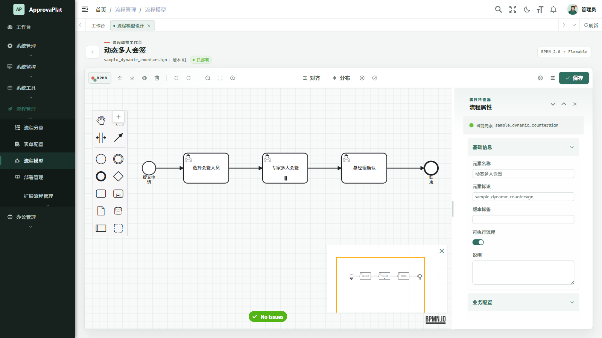
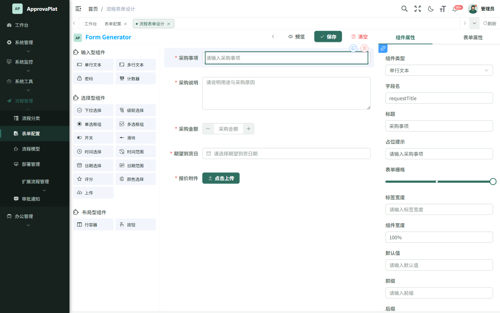
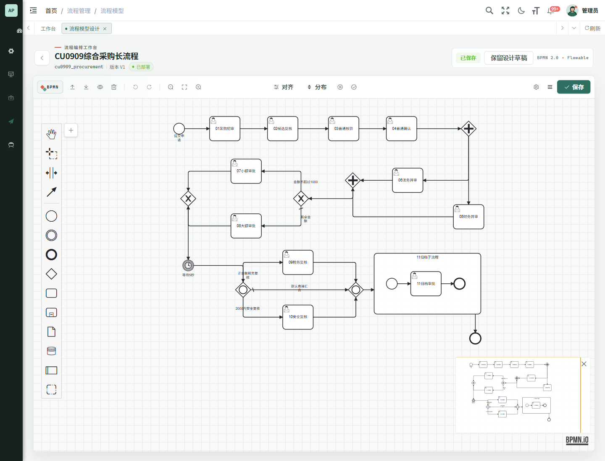
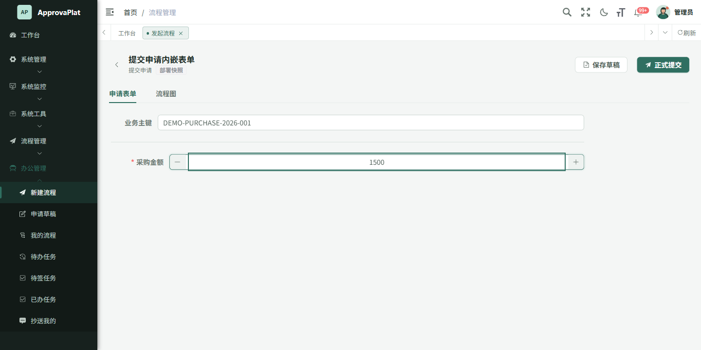
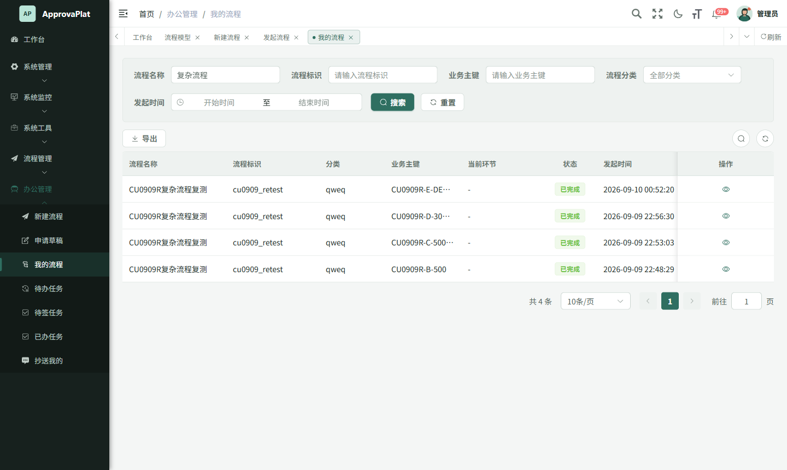
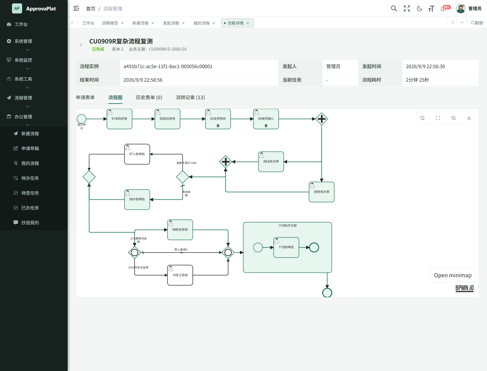
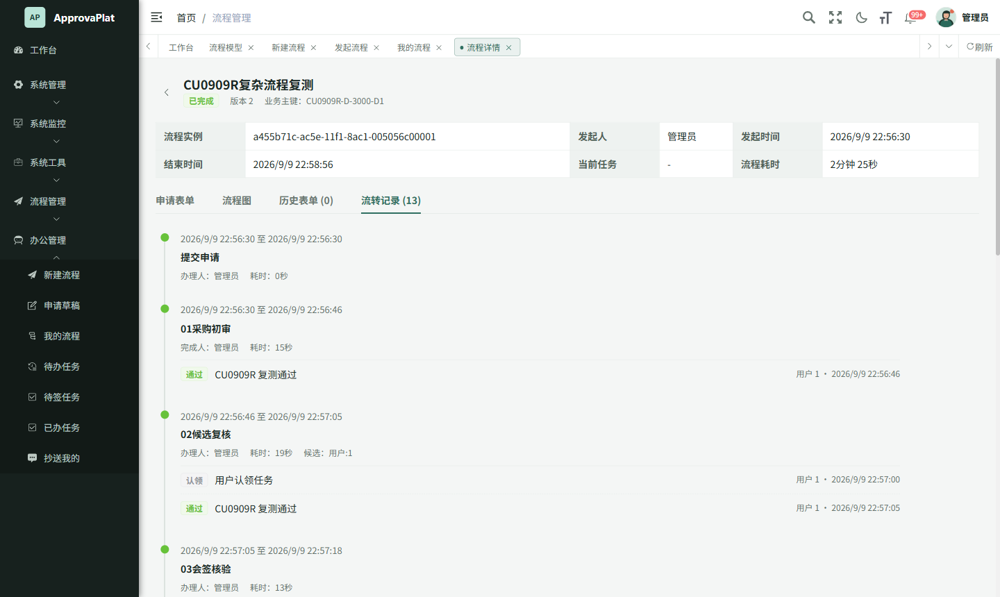
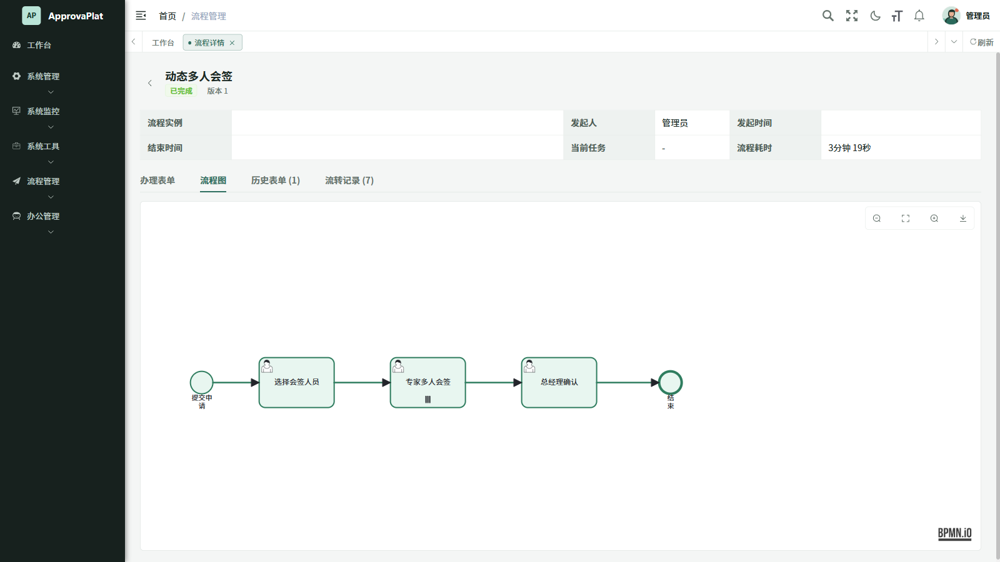

<div align="center">

# ApprovaPlat

**An open-source business workflow and back-office platform.**

Built on RuoYi, Flowable 8, Spring Boot 4, and Vue 3, covering process design, deployment, submission, task handling, authorization, data, and audit.

[中文](README.md) | **English**

[Screenshots](#screenshots) · [Quick start](#quick-start) · [Current capabilities](#what-works-today) · [Production acceptance boundary](#production-acceptance-boundary)

[](https://github.com/flowable/flowable-engine) [](https://spring.io/projects/spring-boot) [](https://vuejs.org/) [](#where-the-project-stands) [](LICENSE)

</div>

<p align="center">
  
  <br />
  <sub>Dynamic multi-instance approval process designer</sub>
</p>

<table>
  <tr>
    <td width="33%" align="center"><strong>Design and release</strong><br />BPMN, forms, versions, and deployments</td>
    <td width="33%" align="center"><strong>Requests and approvals</strong><br />Multi-instance tasks, returns, withdrawals, and audits</td>
    <td width="33%" align="center"><strong>Engineering and migration</strong><br />Authorization, data, testing, and operations</td>
  </tr>
</table>

## Project overview

ApprovaPlat is a back-office system built on Flowable 8.

The following workflow is implemented:

```text
Process design
  → Validation and deployment
  → Process submission
  → Flowable execution
  → Task handling
  → History and audit
```

Processes, forms, authorization, business data, and runtime state are maintained together in the project. It can be used to learn Flowable 8, develop workflow systems, or provide a reference for further development.

## Why ApprovaPlat exists

During an internship focused on business-facing back-office product design and full-stack development, I encountered complex manufacturing scenarios. This led me to explore how a production-grade back-office system turns complex workflow, form, authorization, and business-data requirements into features and connects them through software.

After studying projects such as [RuoYi-Vue](https://github.com/yangzongzhuan/RuoYi-Vue), [Yudao](https://github.com/YunaiV/ruoyi-vue-pro), [Flowable](https://github.com/flowable/flowable-engine), and [bpmn.io](https://github.com/bpmn-io/bpmn-js), I wanted a modern Flowable 8 implementation with a clear open-source scope and complete public code and database assets.

ApprovaPlat therefore uses Flowable 8 as its runtime core, connects design, deployment, submission, task handling, authorization, data, and auditing, and maintains business rules, SQL, documentation, and verification entry points in one repository.

The project is still early, and its core code, SQL, documentation, and tests will remain public. Feedback from experienced developers is always welcome, and I hope anyone building, planning, or migrating a workflow system can find implementations and lessons here that are genuinely useful.

## Where the project stands

ApprovaPlat is currently at an early stage. The capabilities below exist in the repository today.

Today, process design, deployment, submission, task handling, history, and audit queries form a working path. Flowable 8 executes the workflows, MySQL stores business data, and Redis handles login state and caching. It can serve as a learning, evaluation, or secondary-development base; production use follows successful deployment, capacity, failure, and recovery acceptance in the target environment.

It is currently best suited to:

- Learning Flowable 8 and how a workflow system connects its frontend, backend, authorization, and data.
- Serving as a reference implementation or foundation for a new workflow project.
- Validating target capabilities for a Flowable version upgrade or migration from another workflow engine.
- Running a pilot before production while completing deployment, capacity, and failure testing for the target environment.

## What works today

### Design and release

- Manage process categories, dynamic forms, BPMN models, versions, and deployment state.
- Import, export, preview source, run linting and token simulation, and edit node properties in the BPMN.js designer.
- Validate BPMN on the backend before deployment. Freeze form, extension, DMN, and SLA snapshots on deployment, then suspend the old definition while in-flight instances continue.

### Requests and approvals

- Use dedicated views for new requests, my requests, inbox, claimable tasks, completed work, and CC notifications.
- Start, withdraw, cancel, terminate, suspend, and activate process instances; claim, approve, delegate, transfer, return, and reject tasks.
- Run ALL and ANY multi-instance approval modes, add or remove approvers dynamically, and handle revision conflicts in multi-instance approval and return flows.
- Persist submission and deployment form snapshots. Attachment handling covers object-level authorization, quotas, binding, downloads, deletion, and physical cleanup.

### Advanced workflows and integration

- Use exclusive, parallel, inclusive, and event gateways.
- Run controlled repeat approval with an exit condition, maximum iterations, and an audit trail for each round.
- Use BPMN Error, Escalation, boundary timers, business calendars, approval SLAs, and DMN decisions.
- Use controlled Java/CEL, HTTP and SQL connectors, integration credentials, and runtime event endpoints.
- Participant, MessageFlow, and multi-pool collaboration are backed by persistent delivery, idempotency, ordering, retries, dead letters, and auditing.

### Authorization, data, and operations

- Separate design, submission, approval, administration, and audit duties, with object-level authorization for instances, tasks, deployments, attachments, and audit data.
- Keep Flowable and business data in the same primary datasource and transaction boundary. Backend runtime facts and the formal database form the single authoritative workflow state.
- Reload process instances, deployed BPMN, and historical execution paths.
- Provide health checks, runtime snapshots, Micrometer/Prometheus metrics, attachment cleanup locks, and runtime readiness validation.

## Screenshots

### Purchase request form

Configure purchase details, amounts, delivery dates, and quotation attachments in the form designer.



### Procurement approval process

The process includes an initial procurement review, parallel finance and legal reviews, an amount-based branch, a timer wait, and an archiving subprocess.



### Submission form and instance list

Complete a purchase request, then save a draft or submit it for approval.



Use My Requests to find applications and check their current step and approval status.



### Execution trace

This purchase request has an amount of **3,000**. It passes through parallel finance and legal reviews, large-amount approval, and tax review before archiving. Green highlights show the nodes and connections that actually ran.



### Approval history

View the handler, elapsed time, claim records, and approval comments for each step.



### Dynamic multi-instance approval

The view below shows a dynamic multi-instance approval completed in a real frontend, backend, Flowable, MySQL, and Redis environment. The page reloads the instance state and deployed BPMN, then highlights the path that actually ran.



## Production acceptance boundary

- Production fixes `flowable.database-schema-update=false`; maintained repository SQL and runtime validation provide the schema update path.
- Controlled loops execute business repetition, while standard loops retain XML round-trip support.
- Async executors are disabled by default. Enable them only after validating the database, topology, capacity, monitoring, and execution coordination for timers, SLAs, and background work.
- Validate multi-node operation and failure recovery, shared attachment storage, idempotency and failure recovery for external HTTP/SQL calls, capacity, backup recovery, and long-duration stability in the target environment before production use.

## Quick start

### Requirements

- JDK 17+
- Maven 3.9+
- Node.js 20+
- npm 10+
- Docker with Docker Compose
- PowerShell 7.4+ (`pwsh`) for the repository verification scripts

### First-time development

Set the existing development environment's connection values in the current PowerShell process:

```powershell
$env:APPROVAPLAT_MYSQL_VOLUME = '<existing volume name, or a new name for first use>'
$env:APPROVAPLAT_MYSQL_ROOT_PASSWORD = '<administrator password for this instance>'
$env:RUOYI_DB_USERNAME = '<development account other than root>'
$env:RUOYI_DB_PASSWORD = '<development account password>'
```

For an existing volume, use its existing credentials. These variables create accounts only when initializing an empty volume; they do not change existing MySQL accounts. Start MySQL 8 and Redis from the repository root:

```powershell
docker compose up -d
docker compose ps
```

When the selected volume is initialized for the first time, MySQL runs the [initialization script](docker/mysql/init.sh). Wait until both MySQL and Redis report `healthy` in `docker compose ps` before starting the application. An existing volume is not initialized again.

Install the frontend dependencies:

```powershell
Set-Location ruoyi-ui
npm ci
```

Open the repository root in IDEA and import the root `pom.xml`. Set the same `RUOYI_DB_USERNAME` and `RUOYI_DB_PASSWORD` in the run configuration, then run `RuoYiApplication` from `ruoyi-admin`. An already running IDEA process does not inherit variables set later in PowerShell. Druid Monitor and the upload directory can use their defaults.

Start the frontend from `ruoyi-ui`:

```powershell
npm run dev
```

Open `http://127.0.0.1:1024`. The clean local baseline account is `admin` with initial password `wang`. Use it for local development and complete password rotation before exposing the service beyond your machine.

### Daily development

Run from the repository root:

```powershell
docker compose up -d
```

Then run `RuoYiApplication` in IDEA and execute the following command from `ruoyi-ui`:

```powershell
npm run dev
```

### Stop and local defaults

Use the following command for a normal stop:

```powershell
docker compose down
```

The application and verification share local MySQL at `127.0.0.1:13306/approvaplat`. Supply the application credentials through `RUOYI_DB_USERNAME` and `RUOYI_DB_PASSWORD` in the current process. Compose additionally requires the explicitly approved `APPROVAPLAT_MYSQL_VOLUME` and `APPROVAPLAT_MYSQL_ROOT_PASSWORD`. Initialization is for an approved empty volume only; never replay it over existing data. Redis uses `127.0.0.1:6379` without a password. The default upload directory is `${user.home}/.approvaplat/uploads`. Database verification also requires the instance registration and explicit per-run opt-in described in [CONTRIBUTING.md](CONTRIBUTING.md).

Druid Monitor is disabled by default. To enable it temporarily, set `DRUID_MONITOR_ENABLED=true`, open `http://localhost:8080/druid/`, and sign in with local username `ap` and password `123456`.

### Upgrading existing data

The runtime reads only v2 workflow artifacts. If an existing database contains v1 deployment resources, stop the application and follow the [artifact migration guide (Chinese)](docs/workflow-artifact-v2-migration.md) to inspect, back up, and migrate them before starting the new version. Do not replay empty-database initialization SQL over business data.

See the [architecture guide](docs/architecture.md) for current module responsibilities and transaction boundaries, and the [verification history](docs/verification-history.md) for completed checks and their scope. Both documents are in Chinese.

## Development and testing

Run the daily quick checks from the repository root:

```powershell
pwsh -NoProfile -File ./bin/verify-rules.ps1 -Mode Quick
```

`Quick` runs backend local/H2 tests, frontend lint/contracts/build, and architecture and diff checks. It removes external MySQL/Redis test environment variables in the Maven child process. Real MySQL/Redis and browser acceptance require their own modes and prerequisites. Direct `mvn clean verify` still selects database tests from the current environment; see [CONTRIBUTING](CONTRIBUTING.md#验证).

For frontend-only checks:

```powershell
Set-Location ruoyi-ui
npm run lint
npm run test:contracts
npm run build:prod
```

Tests cover core Flowable workflow chains, transactions, authorization, idempotency and concurrency conflicts, runtime fact reuse, frontend request contracts, and browser scenarios for drafts and workflow observation. See [CONTRIBUTING](CONTRIBUTING.md#验证) for H2, optional MySQL, and browser prerequisites and coverage limits.

## Technology

| Area                  | Technology                                             |
| --------------------- | ------------------------------------------------------ |
| Backend               | Java 17, Spring Boot 4.0.6                             |
| Workflow and decision | Flowable 8.0.0 Process / DMN                           |
| Data                  | MyBatis, MySQL 8, Redis                                |
| Frontend              | Vue 3.5.26, Vite 6.4.3, Element Plus 2.13.1            |
| Designer              | BPMN.js 18.22.0                                        |
| Rules and connectors  | CEL, JSqlParser, controlled Java / HTTP / SQL          |
| Observability         | Spring Boot Actuator, Micrometer, Prometheus           |
| Verification          | JUnit Jupiter 6.0.3, frontend contract tests, browser E2E, production builds |

## Repository layout

```text
ApprovaPlat/
|- pom.xml       Maven reactor entry point
|- ruoyi-*/      Spring Boot backend modules and Flowable domain module
|- ruoyi-ui/     Vue 3 frontend, workflow designer, and frontend tests
|- sql/          Database baseline, business schema, and menu permissions
|- bin/          Formal verification, environment registration, and artifact migration tools
`- docs/         Architecture, verification, migration guides, and README image assets
```

## Contributing

Issues and pull requests are welcome, especially when they bring a real approval scenario, migration problem, or hard-earned lesson into the project. For bug reports, include the environment, reproduction steps, expected behavior, and actual behavior. Feature requests can describe a specific approval scenario.

See the [contribution guide (Chinese)](CONTRIBUTING.md) for development conventions, verification commands, and pull request requirements.

For a new BPMN element or approval action, explain how it is edited, how it runs, who may use it, where its data is stored, what remains after failure, and how it will be tested.

## Upstream projects and license

ApprovaPlat builds on open-source projects including [RuoYi-Vue](https://github.com/yangzongzhuan/RuoYi-Vue), [Flowable](https://github.com/flowable/flowable-engine), and [bpmn.io](https://github.com/bpmn-io/bpmn-js).

This is an independent open-source project with its own release and support boundaries. The code is available under the [MIT License](LICENSE).
