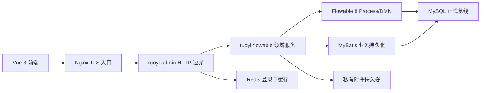
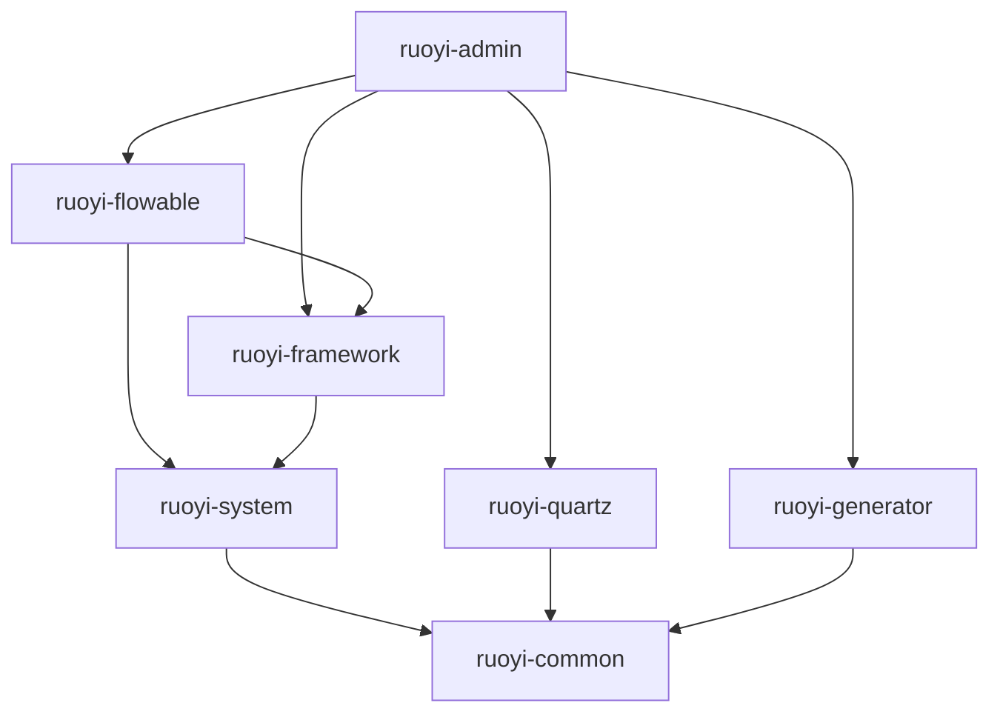

# 审批平台架构

## 产品定位

ApprovaPlat 是基于 RuoYi 前后端分离框架和 Flowable 8 的企业审批平台。每项正式能力都由真实业务入口、后端规则、正式持久化、审计与运维链路共同实现。

平台覆盖流程分类、表单、BPMN 模型、部署、DMN、扩展注册表、HTTP/SQL 连接器、运行事件、发起与审批工作台、附件、审计和实例运维。

## 运行结构

## 模块职责

- `ruoyi-admin`：HTTP 协议、参数校验、登录用户权限、下载响应和操作日志入口。
- `ruoyi-flowable`：对象授权、状态校验、事务、Flowable 命令、业务表写入、附件和集成能力。
- `ruoyi-system`：用户、角色、部门、菜单和系统操作日志主数据。
- `ruoyi-framework`：认证、安全过滤器、实时权限查询和 Web 基础设施。
- `ruoyi-common`：基础类型、通用协议和跨业务工具，不反向引用具体业务模块。
- `ruoyi-quartz` / `ruoyi-generator`：定时任务管理与代码生成，作为独立功能由 `ruoyi-admin` 装配。
- `ruoyi-ui`：真实 API 调用、管理页面、工作台、BPMN 设计/查看和表单运行时。
- `sql/flowable`：Flowable 官方表、工作流业务表和菜单权限。

后端是一个 Maven 多模块应用，业务代码通过直接依赖协作。当前主要依赖方向为：

工作流对 `ruoyi-framework` 的依赖用于复用实时权限源。移动包或增加接口时必须保留这一安全语义，不能替换成登录时的权限快照。

## 前端代码边界

| 位置 | 拥有的职责 | 协作方式 |
| --- | --- | --- |
| `src/views` | 路由参数、页面请求、加载与提交状态、导航 | 调用 `src/api`，通过 props 和事件组合组件 |
| `src/api` | URL、HTTP 方法、参数和请求配置 | 统一使用 `utils/request`，不决定流程状态或办理资格 |
| `src/components/workflow` | 设计器、查看器、表单和列表等工作流交互 | 展示后端视图；编辑模型由所在组件管理 |
| `workflow/designer/*Domain.js` | 当前 BPMN 的属性编辑规则与字段选项 | 通过明确传入的目录和命令栈操作协作 |
| `workflow/designer/designerFormFieldCatalog.js` | 表单/权限编辑所需的中性描述，以及当前 XML 的有效字段请求状态 | 按节点与流程读取服务端投影，失效并丢弃旧响应；不推演业务资格 |
| `WorkflowModelService.authorFieldCatalog` | 用户主键、循环、条件与调用映射字段投影 | 复用权限化表单、正式字段类型与冲突规则；前端只消费有效选项，保存/部署重新校验 |
| `workflow/form` | 安全渲染描述、字段组件和表单输入 | 使用部署或提交快照，不读取设计器内部状态 |
| `src/components/Crontab` | Cron 输入与预览 | 秒、分、时、月共用 `NumericField`；日、周、年的特殊语法各自维护 |
| `src/store` / `src/utils` | 应用级状态 / 无页面归属的复用能力 | 页面局部状态留在页面，工作流规则留在工作流目录 |

前端可以整理数据以满足展示和编辑：字段标签、选项、格式、空态、重复提交锁和过期响应丢弃都属于交互职责。流程状态、对象关系、可办理动作、下一办理人要求和多实例 revision 由服务端决定；前端直接消费正式视图，写入时由服务端再次核验。

设计器的作者态与已部署运行态具有不同生命周期。作者态写入必须经过 `bpmn-js` 命令栈以支持撤销/重做；运行表单消费冻结快照。两者不能用一份共享可变对象连接，也不能用浏览器存储代替模型或申请持久化。

## 工作流后端代码边界

| 位置 | 职责与约束 |
| --- | --- |
| `controller/workflow` | HTTP 参数、入口权限、响应和导出；把业务命令交给服务 |
| `flowable/authorization`、`identity` | 当前有效身份和实例、任务、附件等对象授权 |
| `flowable/service/model` | 作者模型、版本、部署编译、资源引用与不可变部署制品 |
| `flowable/service/process` | 发起与申请草稿、实例查询与详情、实例生命周期和运行事件 |
| `flowable/service/task` | 审批用例、退回/重提、办理人、多实例轮次与任务状态不变量 |
| `flowable/service/notification`、`retention` | 通知投递与保留期清理，各自拥有重试和批处理边界 |
| `flowable/engine` | 引擎命令的事务、认证上下文与异常翻译 |
| `flowable/mapper`、`domain` | 正式持久化查询、实体和请求/响应契约 |

用例服务负责安排步骤，状态服务负责维护不变量。普通退回和整组退回在迁移完成后都调用 `WorkflowReturnedTaskStateService.enterReturned`：先冻结原办理配置，再建立申请人独占任务和 `returned` 双状态；执行树迁移、轮次 CAS、审计与通知仍按各用例的事务顺序执行。

普通保存仅检查尚未写入 XML 的界面输入，再向正式保存接口提交一次；资源目录分别加载，失败显示诊断并保留其他成功目录，刷新可恢复。引用资格和业务规则由后端按本次请求裁决，主动校验与完整预检保持独立入口。

模型部署和预检共用 `WorkflowModelService.prepareDeployment`。命令事务内读取当前模型及作者 XML；同一正式表单模板解释一次，各节点派生独立权限视图，字段和规则消费者直接使用根节点。作者和执行模型在边界分离一次，扩展、条件、循环、参与者、DMN、调用活动、SLA、监听器依次修改同一执行模型，最后输出并保留必要标准引用与池身份。领域阶段直接返回实际快照列表，不传递中间 XML。

正式部署由 Flowable 接纳执行资源并原子冻结制品，模型写回使用 Flowable revision 防止并发覆盖。预检使用相同编译结果执行官方结构校验但不写部署；下一次部署仍重新装载和裁决。运行时从持久化快照装载表单是新的数据边界，同次系统输出检查和任务完成直接复用这次解析结果。

任务完成、取消、撤回、驳回、退回、重提由对应应用服务直接接收 Controller 请求。详情查询仅依赖退回与重提能力服务，已办查询仅依赖撤回能力服务；不再通过汇集全部用例的转发门面。应用服务仍通过 `WorkflowEngineOperations` 建立原有身份、事务与异常边界。

条件分支、受控循环和参与者契约共用包内 `WorkflowBpmnProperties` 读写 Flowable 属性容器。该类仅处理容器遍历、重复属性检测与指定属性移除；保留属性范围、值校验和错误消息属于各领域契约。其他扩展和非所属属性按原有顺序保留。

## 关键调用链

| 场景 | 代码入口与业务边界 |
| --- | --- |
| 设计与发布 | `model/design.vue` → `ProcessDesigner` → `api/workflow/model` → `WfModelController` → `WorkflowModelService` → 编译服务、Flowable 和部署制品 |
| 申请提交 | `work/start.vue` → 草稿 API → `WfProcessDraftController` → `WorkflowProcessDraftService` → `WorkflowProcessStartService`；提交时重验表单、附件和版本 |
| 详情与办理 | `work/detail.vue` → process/task API → 对应 Controller → 详情投影或任务用例；读入口投影 capability，写入口核验实时状态 |

## 精简与重构约束

- 同一业务规则只有一个实现所有者。重复的状态变更、解析和查询准备优先收敛到现有模块；消费者保留自身的业务决策。
- 仅当代码有独立状态、生命周期或变化原因时拆分文件。简单委托不再增加 facade、factory、registry 或单实现接口。
- 删除前检查生产调用、Spring 注册、MyBatis XML、路由、模板、权限配置和正式测试；文本搜索无直接调用不足以证明无用。
- 相似的校验先比较授权场景、事务顺序、错误码和数据范围。工作台分页上限为 200，运维查询上限为 100，不能为统一工具而改变各自协议。
- 每次收敛同步调用方、正式文档与相关注释，不保留已被替代的内部兼容入口。HTTP、DTO、数据库和 BPMN 协议变化必须单独明确迁移方案。
- 以维护成本和行为验证衡量结果：同时记录生产代码净变化、调用跳转、公共入口与测试证据。纯编译、源码断言或文件变短不等于业务链路通过。

## 接口边界

- `com.ruoyi.web.controller.workflow` 下的工作流 Controller 提供正式登录用户入口，并由五角色 RBAC 矩阵冻结方法、路径和权限表达式。
- 每个流程实例、任务、附件、部署和审计查询同时执行 URL 权限与对象授权，验证当前用户和目标对象的业务关系。

## 部署展示与授权读取

管理 XML、发起预览和实例详情先完成各入口当前请求的身份/权限与对象定位，再有界读取已部署 BPMN（2 MiB）并严格 UTF-8 解码。显示既有版本不重新检查作者字段、表单、监听器或可部署性；资源缺失、读取/解码失败和大小限制仍报告。作者保存、完整预检与正式 Flowable 部署分别保留输入、编译和执行结构约束。

详情、观察和等待在同一 REPEATABLE_READ 事务内复用已授权的真实任务/实例；独立请求和写入仍重新授权。AccessSnapshot 内部对象不进入 JSON。变量投影只查询授权根/任务局部作用域的可读字段元数据，空字段不查询；大正文在类型及单项/累计限额通过后按同一作用域读取，保留受控 JSON、String ObjectInputFilter 和响应容量限制。元数据不读取 Blob 正文，也不遍历不可读全域变量。同一读事务观察一致快照，下一事务读取新提交值；引擎写入回滚后投影不变。

Flowable 8 标量按实际存储列解释：LONG_ 对应 short/integer/long、boolean 和毫秒 date/instant，DOUBLE_ 对应 double，TEXT_ 对应 string、uuid、bigdecimal/biginteger；保持原 JSON 值形态。行内/Blob JSON、longJson 及旧 string 标签的长字符串通过受控解码兼容；serializable 不作为业务投影输出，禁止任意对象反序列化。当前变量正文保留单项 1 MiB、累计 2 MiB 读取上限及单文本 64 KiB 输出限制，提交快照使用其独立限额。

## 数据与事务

- Flowable `ACT_*` 与项目 `wf_*` 共用主数据源和 Spring 事务管理器。
- 一次审批动作涉及的引擎状态、业务记录、附件绑定和审计结果必须原子提交或整体回滚。
- 已部署流程以不可变表单、扩展和 DMN 快照作为运行语义；编辑态模板变化只作用于后续部署。
- 生产配置固定 `flowable.database-schema-update=false`，数据库结构通过仓库维护的正式 SQL 升级。

## 安全边界

- 用户身份只来自正式 `sys_user`、`sys_role`、`sys_dept` 数据。
- BPMN 扩展通过服务端已安装实现目录选择，类名、脚本和网络访问均由固定白名单控制。
- 附件只保存受控相对路径，文件位于 Web 根目录之外；上传、读取和删除同时执行权限、对象、容量和生命周期校验。
- 凭据通过受控环境变量、私有密钥文件或加密密钥系统注入；源码、SQL、发布包清单和测试报告只保存公开配置与密钥引用。

## 运行原则

- executor 默认关闭，在数据库、拓扑、容量、监控和唯一执行协调全部验收通过后启用。
- 单节点使用本地持久卷；多节点共享 Token 密钥、附件存储和经过验证的 executor/清理锁拓扑。
- readiness 汇总数据库、Redis、工作流运行快照、附件存储和关键低基数指标，全部达到就绪状态后接收流量。

## 服务协作

- 五种基础任务动作由 `WorkflowTaskActionService` 在统一引擎事务内直接编排，抄送计划在动作前准备、动作与审计后写入，最后发布通知。
- 实例与任务列表先取得当前页，再按所需 ID 批量读取展示事实。`WorkflowProcessQuerySupport.loadUserNames` 只读取该页用户主键与原始昵称，不加载完整用户、部门和角色，也不跨请求缓存。身份沿用 `Long.valueOf` 解析；缺失用户、空白昵称及无法解析的身份保留原输入 ID，非空白昵称保留首尾空格，空白身份显示 null，数据库故障继续抛出。抄送仍显示事件时保存的姓名快照，多实例成员名称仍使用其原有昵称／账号回退规则。
- 详情页的 `useWorkflowUserOptions` 只拥有远程搜索和标签状态。审批、抄送、加签各自创建实例并绑定正式接口；并发刷新时可清除搜索结果而保留已选标签。入口权限统一使用现有 `$auth`，资格仍取服务端 capability。
- 设计器三个领域各自定义属性初始状态并回读所属 BPMN 属性。宿主固定装配读取顺序、管理选择和命令栈；领域方法不暴露只供宿主逐字段搬运的内部读取函数。
- 注释说明业务原因、边界和失败语义。构造器不重复列举已由签名表达的依赖，record 的字段协议集中在类型声明。

## Cron 导入与 Quartz 预览

`Crontab/week.vue` 只在用户操作控件时发布更新；星期名 `SUN` 至 `SAT`、范围、列表、`#1` 至 `#5`、最后一个星期的表达式可回填控件，跨周范围和七个星期均可选择。导入和重开不改写原式，未由控件覆盖的 Quartz 语法继续原样保留，由后端判断合法性。

`Crontab/index.vue` 在导入和重置回填期间忽略旧字段控件的更新回声，保留完整原始表达式；首次用户修改之后才重新拼接字段。修改星期时，未编辑的 `JAN,JUN` 等月份原式仍保留；快速连续导入只采用最新输入。既有月份、日和年控件仍不能完整可视化所有 Quartz 语法，例如月份名 `JAN/JUN`、日字段 `LW` 和超出控件范围的年份；编辑器支持保留这些原式并完成导入、预览与直接确定；可视化编辑范围以相应控件为准。

Cron 预览由后端 Quartz 计算，入口为 `GET /monitor/job/cron/preview?cronExpression=...`，使用现有 `monitor:job:add` 或 `monitor:job:edit` 任一权限。输入仅为原始表达式，非空且最长 255 字符，与任务字段约束一致；服务端以当前时间起最多查询五次，不接受客户端次数、起点、时区或任务执行参数，不创建、保存或执行任务。

成功响应沿用 `AjaxResult`，`data` 为 `{ "timeZone": "Asia/Shanghai", "executionTimes": ["2030-01-07 09:00:00 +08:00"] }` 这样的结构（时间仅为示例）。表达式有效但无未来时间时返回空数组，不足五次时返回实际次数。非法输入沿用管理端业务错误响应，由页面显示失败原因；断网或服务不可用时显示预览失败，不回退到前端猜测。

时区来自 Quartz `CronExpression` 的 JVM 默认时区，与 `ScheduleUtils` 现有未指定 `inTimeZone` 的正式调度一致。时间字符串附带当次 UTC 偏移，前端直接显示；`application.yml` 的 Jackson `GMT+8` 配置与浏览器时区不参与计算或二次转换。预览表示 Cron 计划时间，实际任务运行仍受任务状态、调度器可用性和已有 misfire 策略影响。
