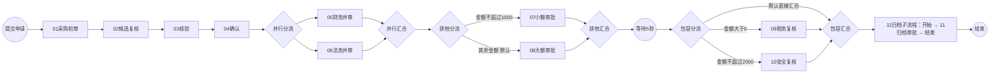

# 流程引擎真实前端操作测试记录（2026-09-09）

> 状态：部分执行，尚未完成设计器全内容覆盖，也尚未取得长流程正常结束的证据。
>
> 已通过真实鼠标、键盘在前端搭建并部署一个 23 节点、25 条顺序流的模型；执行中确认会签/或签保存阻断、嵌套子流程发起阻断，以及当前环境的定时器阻断。后续隔离验证进行到普通审批节点 04 时，Windows 锁屏中断桌面操作。

## 1. 测试方式与环境

- 工作目录：`D:\ruoyiflowable`；代码基线：`9ddac99`。
- 日期及时间：2026-09-09，Asia/Shanghai；最后可用业务页面证据为 08:50，08:56 确认 Windows 锁屏。
- 前端：本机 Edge，`http://127.0.0.1:1024/`；后端：本机 8080；使用现有 MySQL、Redis。
- 会话账号：管理员 `admin`。指定人员选择器中本次可选择的是管理员；没有形成多账号、多角色分别收件的证明。
- 当前工具环境未提供名为 computeruse 的专用工具。本次使用 Windows 原生鼠标、键盘输入及桌面截图模拟操作；未使用 DOM 定位、页面脚本注入、接口发起/完成流程或数据库写入代替用户步骤。
- BPMN 最初由前端画布搭建；证据文件来自前端“XML 预览 → 复制”。隔离版本通过文件选择器导入这些前端产物，并继续在画布删除节点、修改名称、保存、部署；没有手写或程序生成 BPMN 作为测试模型。
- 源码只读检查用于解释已出现的错误；不作为 UI、运行时通过证据。没有修改业务源码或执行本地提交。

证据目录：[output/computeruse-20260909](../../output/computeruse-20260909)。原始动作日志为 [actions.jsonl](../../output/computeruse-20260909/actions.jsonl)，每条含时间、动作和对应截图路径。日志坐标为实际 2560×1600 桌面坐标；截图等比例缩至 1920×1200。

## 2. 实际建立的模型及版本

| 模型/版本 | 节点与连接 | 前端结果 | 运行结果 |
| --- | --- | --- | --- |
| CU0909综合采购长流程，`cu0909_procurement`，最初会签/或签草稿 | 23 节点；最早复制草稿 24 条连接，后续画布补齐连接 | 03 会签、04 或签已配置指定用户，但保存失败，见 F01/F02 | 未部署、未运行 |
| CU0909综合采购长流程，V1，08:26:24 部署 | 23 节点、25 条顺序流；03/04 改为普通审批 | 保存、部署成功 | 点击发起时报错，申请表打不开，见 F03 |
| CU0909路由隔离验证，`cu0909_routes`，V1 | 中间操作版本，仍含子流程和内部开始节点 | 保存、部署；不作为有效的“已去掉子流程”对照 | 不计入有效运行验证 |
| CU0909路由隔离验证，V2，08:32:25 部署 | 19 节点、22 条顺序流；画布删除整个展开子流程，保留定时器 | 保存、部署、发起成功 | U1 完成 7 个人工节点，停在 PT5S 定时捕获，见 F04 |
| CU0909路由隔离验证，V3，08:47:45 部署 | 18 节点、21 条顺序流；在 V2 基础上画布删除定时器 | 保存、部署、发起成功 | U2 完成 01、02、03，04 待办已收到；随后锁屏，未继续 |

计数包含流程内开始、结束、任务、网关、事件及子流程容器，排除顺序流、扩展属性、DI 图形。23 节点版本含 11 个人工任务、6 个网关、2 个开始事件、2 个结束事件、1 个定时事件及 1 个子流程容器。计数从前端复制的 XML 只读解析得到，详见 [bpmn-inventory.json](../../output/computeruse-20260909/bpmn-inventory.json)，其中保留 SHA-256。

原始文件：

- [最初会签/或签配置草稿](../../output/computeruse-20260909/ui-copied-original-multisign.bpmn)：用于检查多实例配置，不是最终连通、已保存的版本。
- [已保存的 23 节点普通审批版本](../../output/computeruse-20260909/ui-copied-saved-ordinary.bpmn)。
- [路由隔离 V2](../../output/computeruse-20260909/ui-copied-routes-v2.bpmn)。
- [去定时器后的路由隔离 V3](../../output/computeruse-20260909/ui-copied-routes-v3.bpmn)。

## 3. 长流程结构与输入

03/04 在最初草稿分别使用会签/或签，保存阻断后改为普通审批。V2 删除 SP 整体；V3 进一步删除 T。删减版本只用于隔离验证，不能据此认定原始完整模型通过。

开始节点在“内嵌表单”中配置：字段 `amount`、变量 `amount`、显示名“采购金额”、类型“整数”、必填。01、03—11 普通任务使用发起人本人；02 使用指定候选用户管理员，需要进入“待签任务”认领。

| 场景 | 输入 | 预期分支 | 本次实际结果 |
| --- | --- | --- | --- |
| U1，V2，`CU0909-U1-500` | amount=500 | 05/06 都到达；排他只到 07；定时结束后 09/10 都到达；全部汇合结束 | 已验证 05/06、07；定时器未继续，09/10 未收到，未结束 |
| U2，V3，`CU0909-U2-3000` | amount=3000 | 05/06 都到达；排他只到 08；包容只到 09；结束 | 已到 04；其后的分支和结束未执行 |
| U3，V3，计划使用 `CU0909-U3-500` | amount=500 | 排他到 07；包容到 09/10；完成一条后仍等待另一条，最终结束 | 尚未创建实例 |

包容默认线已配置、保存和部署，但当前两个条件覆盖了所有正常整数输入，不能用这组数据证明默认线会在运行时触发。需要调整独立用例条件，构造全部条件不匹配的输入后补测。

## 4. 问题记录

### F01 — 会签已指定人员，仍因缺少办理身份无法保存（高，已复现）

前置：23 节点模型中选中“03会签核验”。

1. 在业务配置中将审批方式设为“会签”。
2. 审批人来源选择“指定用户”，选择“管理员（admin）”。
3. 画布出现多实例标记，右侧保留所选人员。
4. 点击保存；再次确认配置并重试。

预期：指定用户配置满足会签所需身份，模型可保存，后续按人员创建多实例审批。

实际：流程校验报 `BPMN_IDENTITY_INVALID`，提示“用户任务 ‘03会签核验’ 必须配置办理人、候选用户或候选组”。未保存，运行时会签收件、汇合均不可测。BPMN 下载同样受此校验阻断。

证据：[已选人员与会签模式](../../output/computeruse-20260909/multisign-selected-evidence.png)、[重复保存失败及完整提示](../../output/computeruse-20260909/confirmed-multisign-save-failure.png)、[下载校验失败](../../output/computeruse-20260909/export-check.png)。

只读定位：UI 复制草稿含多实例指定用户及循环配置，缺少普通办理身份字段；[WorkflowBpmnIdentityValidator.java](../../ruoyi-flowable/src/main/java/com/ruoyi/flowable/service/model/WorkflowBpmnIdentityValidator.java) 的 `hasAssignment`（171—176 行）只认办理人、候选用户、候选组或普通受控办理规则，失败在 78 行先抛出。属于前端生成配置与身份门禁之间的契约不一致线索；本次未修复。

### F02 — 或签存在同类保存阻断（高，已复现）

1. 将 03 改为普通审批并配置发起人本人，使前一个阻断不再遮蔽后续节点。
2. 保持“04或签确认”为“或签”，来源为指定用户，人员为管理员。
3. 点击保存并查看错误完整提示。

预期：任一指定审批人完成即可结束该或签节点。

实际：报 `BPMN_IDENTITY_INVALID`，提示“用户任务 ‘04或签确认’ 必须配置办理人、候选用户或候选组”。必须把 04 也改成普通审批后，当前模型才能继续保存。未取得或签运行证据。

证据：[或签模式与所选人员](../../output/computeruse-20260909/orsign-config-before-change.png)、[完整错误](../../output/computeruse-20260909/confirmed-orsign-save-failure.png)。

### F03 — 含展开子流程的模型已部署，但发起入口打不开申请表（高，已复现）

前置：`cu0909_procurement` V1；主流程一个开始节点，展开子流程内另有一个开始节点。普通审批配置已替代 F01/F02 的多实例模式。

1. 保存模型、部署成功。
2. 办公管理 → 新建流程，找到“CU0909综合采购长流程”。
3. 点击该行“发起流程”，再次点击确认可重复出现。

预期：加载主流程开始节点的申请表，允许填写采购金额并提交。

实际：页面停留在流程列表，提示“流程开始节点数据异常”；表单不可达，无法创建该版本的业务实例，内部“11归档审批”因此无法验证收件。

证据：[重复发起失败](../../output/computeruse-20260909/start-blocker-repeated.png)、[已保存图形](../../output/computeruse-20260909/ordinary-save-result.png)。对照：通过画布删除整个子流程后的 V2 可以进入 [申请表](../../output/computeruse-20260909/isolated-start-form.png) 并 [成功提交](../../output/computeruse-20260909/submitted-u1.png)。

只读定位：[WorkflowProcessDefinitionQueryService.java](../../ruoyi-flowable/src/main/java/com/ruoyi/flowable/service/process/WorkflowProcessDefinitionQueryService.java) 的 `requireStartFormSnapshot` 在 617 行递归收集开始节点（第二参数为 `true`），618—620 行要求总数恰好为 1。该模型的 XML 有一个主开始节点和一个嵌套开始节点，与报错条件一致。

### F04 — PT5S 定时节点已到达，但当前环境未继续执行（环境阻断，已观察）

前置：`cu0909_routes` V2，U1，amount=500。

1. 发起申请，依次完成 01；认领并完成 02；完成 03、04。
2. 观察 05/06 同时产生，先完成 06，确认 05 仍在等待。
3. 完成 05，确认排他分支只收到 07；完成 07。
4. 等待超过 5 秒后检查待办、流程图、“我的流程”和实例运维；后续数分钟仍未发现 09/10。

预期：5 秒后继续包容分支，在 U1 的输入下产生 09 和 10 两项审批。

实际：流程图显示定时节点处于活动状态；实例仍“进行中”；后续 09/10 未收到，流程没有结束。没有把它归类为已确认的“人工任务丢失”，因为流程尚未越过定时节点。

实例：`00ad967d-abe6-11f1-9cc9-005056c00001`，发起时间 08:32:56，业务主键 `CU0909-U1-500`。

证据：[定时配置](../../output/computeruse-20260909/timer-selected-for-isolation.png)、[流程图停在定时节点](../../output/computeruse-20260909/u1-timer-transition.png)、[我的流程状态](../../output/computeruse-20260909/u1-my-process-state.png)、[实例运维](../../output/computeruse-20260909/instance-ops.png)、[实例详情入口](../../output/computeruse-20260909/instance-ops-detail.png)。已打开的实例运维页面未显示手动执行定时作业的入口，不能据此推断系统所有页面均不存在该能力。

环境证据：[application.yml](../../ruoyi-admin/src/main/resources/application.yml) 148 行为 `flowable.async-executor-activate: false`，注释说明当前阶段关闭执行器。该配置与观察到的停留一致。本次没有启用全局执行器或强制触发作业；保留原实例，另存 V3 去掉定时节点以继续分支验证。

### F05 — 打开/保存后重载设计器反复出现表单权限标志错误（中，已观察，影响范围待补测）

在新模型进入设计器、普通版本保存后重新加载等操作中，页面出现“表单组件必须声明完整节点权限标志”；部分截图同时出现通知框和 toast。

预期：模型设计器加载必要表单目录；若具体模板不合法，应明确定位模板和字段，方便前端修正。

实际：通用错误反复出现，缺少模板/字段定位。画布仍可编辑，内嵌采购金额表单可正常发起；因此不能说整个表单能力不可用。正式模板下拉曾显示 `qweqw`，本次未完成正式模板绑定和运行，不认定目录为空。

证据：[设计器加载](../../output/computeruse-20260909/designer-open.png)、[普通模型保存后重载](../../output/computeruse-20260909/ordinary-save-result.png)、[路由模型重载](../../output/computeruse-20260909/route-isolation-save.png)。

只读定位：[WorkflowFormTemplateValidator.java](../../ruoyi-flowable/src/main/java/com/ruoyi/flowable/service/WorkflowFormTemplateValidator.java) 464—468 行检查 hidden/readable/writable 三个布尔标志；缺失或类型错误时产生该文案。具体触发模板及数据来源尚未逐一验证，不能直接归因于新建流程配置。

### F06 — 保存错误不便定位画布元素（低，已观察）

F01/F02 的校验表中“元素”列为空；完整节点名藏在截断的消息提示里，需要悬停查看。在 23 节点图上无法直接通过该列定位问题。分支命名校验也曾出现“网关每条出线都必须配置不超过100字的分支名称”，需要再检查各线。

证据：[错误表](../../output/computeruse-20260909/confirmed-multisign-save-failure.png)、[分支名校验](../../output/computeruse-20260909/gateway-name-error.png)。分支名称另有独立保存按钮，未点击该按钮导致名称未提交的操作不单独计作产品缺陷。

## 5. 节点到达与待办证据

| 节点/控制点 | 结果 | 直接证据 |
| --- | --- | --- |
| 内嵌申请表、整数金额提交和详情读取 | 通过（U1、U2 发起） | [U1 提交详情](../../output/computeruse-20260909/submitted-u1.png) |
| 01 采购初审 | U1/U2 均收到并通过 | [U1 待办](../../output/computeruse-20260909/u1-pending-01.png)、[任务详情](../../output/computeruse-20260909/u1-task01-detail.png) |
| 02 候选复核 | 进入待签列表，管理员认领后办理成功 | [待签](../../output/computeruse-20260909/u1-candidate02.png)、[认领后待办](../../output/computeruse-20260909/u1-claimed02.png) |
| 03 普通核验 | U1/U2 均收到并通过 | [U1 待办](../../output/computeruse-20260909/u1-pending03.png)、[U2 下一节点](../../output/computeruse-20260909/u2-pending04.png) |
| 04 普通确认 | U1 通过；U2 已收到但未处理 | [U1 后续并行任务](../../output/computeruse-20260909/u1-parallel-two-arrived.png)、[U2 停留位置](../../output/computeruse-20260909/u2-pending04.png) |
| 并行分流：05 财务 / 06 法务 | U1 同时收到两个独立待办，创建时间同为 08:38:05 | [两个待办同时出现](../../output/computeruse-20260909/u1-parallel-two-arrived.png) |
| 并行汇合 | 先完成 06 后只剩 05，未提前产生 07；完成 05 后才产生 07 | [等待财务](../../output/computeruse-20260909/u1-parallel-waits-finance.png)、[汇合后到 07](../../output/computeruse-20260909/u1-exclusive-small-arrived.png) |
| 排他分支：amount=500 | 只产生 07 小额审批；未产生 08 大额审批 | [07 待办](../../output/computeruse-20260909/u1-exclusive-small-arrived.png) |
| 排他默认线 / 08 大额审批 | 已配置、保存、部署；运行尚未验证 | U2 尚停在 04，不能判为未投递缺陷 |
| 定时捕获 | U1 已到达、未继续 | F04 |
| 包容分流 / 09、10 | 已配置、保存、部署；U1 被定时阻断，U2 尚未到此 | 未收到的原因已有上游阻断，不计作已确认丢任务 |
| 包容汇合 / 默认线 | 运行未执行 | 不以模型保存成功代替运行证明 |
| 展开子流程 / 11 归档审批 | 已在前端创建、保存、部署；模型发起前阻断 | F03，内部节点收件未验证 |
| 正常结束 | 未执行到结束节点 | 本次没有完整运行成功实例 |

## 6. 设计器全内容覆盖账本

“入口可见”只证明菜单存在。“已创建”只证明图形和配置能通过前端操作建立；两者都不等于可部署、可执行。下表保留全部未完成项，禁止按全量通过汇总。

| 设计器内容 | 建模/配置 | 保存/部署 | 运行 | 状态说明 |
| --- | --- | --- | --- | --- |
| 普通开始事件、普通结束事件 | 已操作 | 通过 | 主开始通过；结束未到达 | 内部开始事件关联 F03 |
| 用户任务：普通审批、发起人本人 | 已操作 | 通过 | 01、03、04、05、06、07 已通过 | 非全部用户任务均已到达 |
| 用户任务：候选用户认领 | 已操作 | 通过 | 02 通过 | 仅管理员 |
| 用户任务：会签 | 已指定用户 | 失败 | 阻断 | F01 |
| 用户任务：或签 | 已指定用户 | 失败 | 阻断 | F02 |
| 指定角色/部门、发起时选择/办理时选择等人员规则 | 选项可见 | 未执行 | 未执行 | 无完整配置和收件证据 |
| 排他网关、条件规则、默认线 | 已配置金额条件与默认线 | 通过 | 小额分支通过；默认线待执行 | U2 计划覆盖大额 |
| 并行网关分流/汇合 | 已操作 | 通过 | 通过 | 两任务同时到达及等待汇合均有截图 |
| 包容网关分流/汇合 | 已配置两条件及默认线 | 通过 | 阻断/未执行 | F04；默认线还需独立输入设计 |
| 事件网关 | 高级菜单可见 | 未执行 | 未执行 | 尚未逐节点创建验证 |
| 定时捕获事件 | 已配置 PT5S | 通过 | 到达后阻断 | F04 |
| 消息捕获、信号捕获 | 高级菜单可见 | 未执行 | 未执行 | 尚未验证定义选择及触发入口 |
| 消息抛出、信号抛出 | 高级菜单可见 | 未执行 | 未执行 | 尚未验证投递和接收 |
| 错误边界、升级边界、补偿边界 | 高级菜单可见 | 未执行 | 未执行 | 尚未验证附着、定义和异常路径 |
| 展开子流程及内部节点 | 已操作 | 通过 | 发起阻断 | F03 |
| 折叠子流程 | 基础工具栏入口可见 | 未执行 | 未执行 | 未独立验证展开/折叠往返 |
| 事件子流程、事务 | 高级菜单可见 | 未执行 | 未执行 | 不将 F03 外推为已实测结果 |
| 调用活动 CallActivity | 高级菜单可见 | 未执行 | 未执行 | 待测引用选择、输入输出映射和子实例任务 |
| 服务任务 | 高级菜单可见 | 未执行 | 未执行 | 待测受控扩展目录及业务参数 |
| 发送任务 | 高级菜单可见 | 未执行 | 未执行 | 待测发送配置、投递结果 |
| 接收任务 | 高级菜单可见 | 未执行 | 未执行 | 待测正式触发入口；该类型本身不应生成普通审批待办 |
| 业务规则任务 | 高级菜单可见 | 未执行 | 未执行 | 待测 DMN 版本选择及命中结果 |
| 其他元素转换项 | 曾打开转换菜单 | 未完成逐项测试 | 未执行 | 不宣称菜单转换项已穷尽 |
| 池/参与者、泳道 | 高级菜单可见 | 未执行 | 未执行 | 待测创建及协作 |
| 数据对象、数据存储、分组、文本注释 | 高级菜单可见 | 未执行 | 不适用/关联行为待测 | 不应按普通人工收件统计 |
| 协作消息流/关联 | 入口可见 | 未执行 | 未执行 | 普通顺序连线成功不代表协作消息流成功 |
| 内嵌表单 | 整数必填字段已配置 | 通过 | 提交/读取通过 | 其他字段类型和权限组合未穷尽 |
| 正式表单模板 | 下拉存在模板 | 未完成绑定验证 | 未执行 | 加载告警见 F05 |
| 自动抄送、节点表单权限、SLA、监听器/扩展配置 | 未逐项完成 | 未执行 | 未执行 | 后续必须补齐 |
| 节点拖放、改名、复制、顺序连线、删除并重连、画布缩放/适配 | 已在真实建模中使用 | 模型已持久化 | 不适用 | 保存后重载图形、名称、线路 |
| 模型保存、部署、版本历史、已部署后保存新版本 | 已操作 | 通过 | V2/V3 均成功发起 | 原始 V1 发起阻断单列 |
| XML 预览/复制、文件导入 | 已操作 | 导入产物继续保存部署 | 不适用 | 全部 XML 来源于本次 UI 操作 |
| BPMN 下载 | 已尝试 | 被校验阻断 | 不适用 | F01；合法模型下载、SVG/JSON 等未全面验证 |
| 其余工具栏功能、布局组合、键盘可达性 | 未逐项覆盖 | 未执行 | 不适用 | 尚不能称“设计器全部内容覆盖” |

高级菜单证据：[palette-and-task.png](../../output/computeruse-20260909/palette-and-task.png)。只读核对清单来源：[AdvancedElementPalette.vue](../../ruoyi-ui/src/components/workflow/designer/AdvancedElementPalette.vue)、[taskCapabilityMap.js](../../ruoyi-ui/src/components/workflow/designer/taskCapabilityMap.js)。代码中存在能力不等于前端实测通过。

## 7. 中断位置、保留数据与续测顺序

08:50 最后业务截图显示 `CU0909-U2-3000` 的“04普通确认”待办。08:54 截图开始为黑屏；08:56 通过普通唤醒按键观察到 Windows 锁屏界面。已请求本机解锁，没有继续盲点或读取/代填系统登录凭据。

模型和实例均保留以便复现，没有撤回、终止、删除本次实例。旧有模型 `123123`、`qweqw` 及列表中的其他历史待办未办理。本次启动的本机前后端继续保留供续测；没有更改异步执行器配置。

续测顺序：

1. 桌面解锁后，先核对当前页面和业务主键，仅继续 U2 的 04；完成并行分支，验证只到 08、包容只到 09，最后确认结束状态和流转记录。
2. 使用 V3 创建 U3（amount=500），验证 09/10 同时出现、只完成一条时仍等待另一条，以及最终结束。
3. 建立独立的高级元素验证模型，通过前端逐项创建/配置账本中未测试的任务、调用活动、事件、边界、事务、协作和数据元素；记录具体不可选、不可连、不可保存、无触发入口及预期接收方未收到的情况。
4. 针对会签/或签、嵌套子流程和定时执行器的阻断完成修复或环境准备后，重跑包含这些元素的完整长流程。隔离版本通过也不能关闭原问题。
5. 补测多账号收件、正式模板及字段权限、自动抄送和其余设计器配置。已有历史测试用例文档不因本次部分执行而整体标记通过。

## 8. 证据使用注意

- 截图文件名部分表示当时尝试验证的目标，不能单靠名字断言结果。例如 `u1-inclusive-two-arrived.png` 不能证明包容分支到达；以截图内业务主键、任务名和本报告记录为准。
- `formal-form-unavailable.png` 的命名不代表模板目录为空，实际下拉曾显示 `qweqw`。
- 保存校验失败前的画布草稿不等于服务端已持久化版本；最初会签草稿与后来普通审批 V1 分开保留。
- 截图顶部的粉色桌面歌词来自项目之外的屏幕叠加层，不计入产品问题。
- 本报告截至锁屏中断时，没有任意一个完整长流程正常结束的证明，未完成全元素验收。
