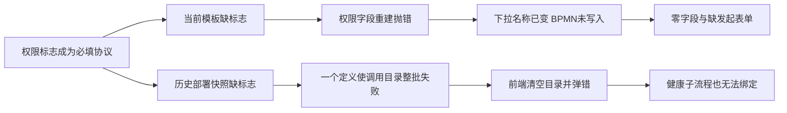

# 流程复测问题的代码深审、缺陷链与修复任务

审查日期：2026-09-10，Asia/Shanghai。工作区：D:/ruoyiflowable，HEAD：9ddac99。

依据：[ComputerUseWorkflowRetestReport-20260909.md](D:/ruoyiflowable/docs/testing/ComputerUseWorkflowRetestReport-20260909.md)。原报告作为现象和证据来源；本次请求范围是审查及任务设计，没有执行报告末尾建议的修复、部署、调度器开启或实例推进。

## 结论与证据边界

问题不是十二个互不相关的节点故障。当前可以追出三条会放大影响的缺陷链：

1. **权限协议收紧后，存量模板和历史部署快照没有在当前环境完成收敛。** 一个坏模板导致正式表单绑定中断；坏部署快照又使调用活动目录整批失败，表现成“没有可调用流程”。
2. **设计器写入命令会同步回读状态，但部分处理函数在第一条命令之后才读取用户输入。** 错误、升级边界因此丢失编码，同一写法还影响边界定时器。
3. **界面允许创建的 BPMN 元素、平台作者模型、Flowable 可执行模型没有完整对齐。** 数据对象名称写在引用对象上；消息抛出是当前引擎原生不支持的类型；第二池没有完整创作入口。底层诊断再被压成通用错误，掩盖实际断点。

继续追查调用活动还复现两个原报告没有走到的问题：**父表单节点权限没有用于后端调用映射校验；同部署其他流程的字段混入目标流程输出目录。** 即使修好空目录，也不能立即宣布调用活动、跨池业务完整可用。

证据层次如下，后文不混用：

| 层次 | 本次实际完成 | 限制 |
|---|---|---|
| 报告证据 | 阅读 R01–R12、原始 BPMN，查看正式模板和第二池截图 | 历史前端运行结果沿用原报告，未重新操作浏览器 |
| 当前源码 | 追到前端状态、控制器、模型校验、调用编译、表单快照、事件消费、Mapper 与调度配置 | 按报告及相邻调用链深入，不是全仓穷举审计 |
| 执行探针 | 当前领域函数、Flowable 8.0.0 验证器、MyBatis 类型别名、调用字段目录 | Java 定向编译当前模板验证器、调用服务和 record 到审查输出目录，其他依赖复用本地构建产物；Node 使用当前源码。合成依赖仅用于隔离具体函数行为 |
| 当前数据库 | 使用应用账号、只读事务读取 ry-vue；验证报告实例、模板及部署制品 | 未修改任何行、触发消息、运行作业或改变实例状态 |
| 历史日志 | 复测时调用目录和注册表异常堆栈与当前代码对应 | 不能替代所有接口的本轮重放 |
| 现有测试 | 两个前端契约测试文件：8 passed，0 failed，0 skipped | 未运行完整 Maven、浏览器端到端、多人并发或修复后验收 |

本次输出只有本文件及 [审查证据目录](D:/ruoyiflowable/output/workflow-deep-review-20260910)。业务代码、既有测试、原报告和原始 BPMN 保持原样；没有暂存、提交、推送。

工作区已有的 13 个修改/未跟踪文件完成 SHA256 前后核对，13/13 未变化：[baseline-verification.json](D:/ruoyiflowable/output/workflow-deep-review-20260910/baseline-verification.json)。本报告中的本地链接已检查路径及行号边界。

原报告的 20 个有效完成实例及已通过元素保留其原有证据等级；本次没有重新核验全部终态。单成员会签/或签、事务正常路径和服务任务下游到达，仍不能扩大为多人竞争、事务回滚或实际变量值全部通过。

## 逐项定位与业务断点

### F01 / P1：R11 正式模板出现“已选名称、零字段”，因为绑定在写入 BPMN 前抛错

当前数据库 `wf_form.form_id=1`、名称 `qweqw`，字段 `field102 / el-input-number` 缺少 `workflowHidden`、`workflowReadable`、`workflowWritable` 三个布尔值。当前服务端模板验证器直接返回“表单组件必须声明完整节点权限标志”。

前端路径是：选择模板 → `updateFormKey()` → 重建权限字段 → `permissionModeFromField()` 抛错 → `syncFormDefinition()` 没有执行。`v-model` 已改了下拉框文本，BPMN 的 formKey 还没有写入，所以随后保存又报“缺少发起表单”。这解释了名称保留、零字段和保存失败为何同时出现。

定位：[formParticipantDomain.js:339](D:/ruoyiflowable/ruoyi-ui/src/components/workflow/designer/formParticipantDomain.js:339)、[updateFormKey:469](D:/ruoyiflowable/ruoyi-ui/src/components/workflow/designer/formParticipantDomain.js:469)、[WorkflowFormTemplateValidator.java:459](D:/ruoyiflowable/ruoyi-flowable/src/main/java/com/ruoyi/flowable/service/WorkflowFormTemplateValidator.java:459)。正式模板列表读取只检查有效记录，没有提供模板是否符合当前协议的状态：[WfFormServiceImpl.java:77](D:/ruoyiflowable/ruoyi-flowable/src/main/java/com/ruoyi/flowable/service/impl/WfFormServiceImpl.java:77)。

复现探针得到 `commandWrites=0`、`uiFormKey=key_1`、`storedFormKey=""`、`fieldCount=0`：[form-probe.jsonl](D:/ruoyiflowable/output/workflow-deep-review-20260910/form-probe.jsonl)。这是当前数据与代码共同确认的问题，不能扩大成“所有正式模板都不可用”。

### F02 / P1：R02 空调用目录实际包含整批请求失败，不能靠再部署一个子流程解决

目录服务查询所有定义，对每个有权引用的定义提取部署表单字段；其中任何一个快照失败都会终止整个列表。前端 catch 再把选项置为空。当前检查的 29 份部署表单中，3 份无法通过权限验证：

| 流程 | 版本 | 开始节点 | 当前失败 |
|---|---|---|---|
| eqwe1 | V2 | start | 缺完整节点权限标志 |
| eqwe1 | V1 | start | 缺完整节点权限标志 |
| qweqwe12123 | V1 | start | 缺完整节点权限标志 |

检查同时读到 29 条 PUBLIC 发起范围记录。授权校验不能解释全部健康定义都不可见；历史日志已经明确记录 `WfCallActivityController.catalog → listReferenceOptions → targetFieldCatalog → extractFieldSpecs → validatePermissionMetadata` 的异常链。

定位：[WorkflowCallActivityReferenceService.java:118](D:/ruoyiflowable/ruoyi-flowable/src/main/java/com/ruoyi/flowable/service/model/WorkflowCallActivityReferenceService.java:118)、[字段校验:582](D:/ruoyiflowable/ruoyi-flowable/src/main/java/com/ruoyi/flowable/service/model/WorkflowCallActivityReferenceService.java:582)、[前端清空目录:351](D:/ruoyiflowable/ruoyi-ui/src/components/workflow/designer/routingCallActivityDomain.js:351)。日志：[sys-error.2026-09-09.log:12077](D:/ruoyiflowable/logs/sys-error.2026-09-09.log:12077)。数据库记录：[database-probe.jsonl](D:/ruoyiflowable/output/workflow-deep-review-20260910/database-probe.jsonl)。

同一目录在设计器挂载时加载，因此即使用户编辑的是内嵌表单，也会收到历史模板权限错误。这可以解释报告中“当前保存成功，同时仍出现模板权限 toast”，不能用那个 toast 推翻已经成功的保存结果。



### F03 / P1：R07、R08 共用的同步状态覆盖；边界定时器也受影响

`updateEventProperties()` 先执行 `updateProperties({ cancelActivity: ... })`，再读取 `propertyState.eventReference` 或定时表达式。第一条命令会同步触发所选元素的 `element.changed`，而监听器调用 `loadPropertyState()`，先重置面板，再从旧 BPMN 回读。新业务编码还没有写入，于是被旧值覆盖。

定位：[extensionEventSlaDomain.js:638](D:/ruoyiflowable/ruoyi-ui/src/components/workflow/designer/extensionEventSlaDomain.js:638)、[同步回读监听:487](D:/ruoyiflowable/ruoyi-ui/src/components/workflow/ProcessDesigner.vue:487)、[状态重置:636](D:/ruoyiflowable/ruoyi-ui/src/components/workflow/ProcessDesigner.vue:636)。

使用生产领域函数、模拟组件实际同步回读时序的探针，ERROR、ESCALATION 的引用均写成空；边界 PT5S 也变为空：[boundary-probe.jsonl](D:/ruoyiflowable/output/workflow-deep-review-20260910/boundary-probe.jsonl)。这是代码时序复现，仍须修复后在真实 bpmn-js 命令栈验证撤销/重做。它与 R01 的**中间捕获定时器已有作业但未调度**是两个不同问题。

报告中删除边界后，产生错误的处理器仍被精确配对门禁拒绝，是正确行为。修复不能删除该门禁。

### F04 / P1：R12 Mapper 把 primitive boolean 当成 Boolean，页面加载连带失败

Mapper 构造映射写 `javaType="boolean"`，MyBatis 实际将该别名解析成 `java.lang.Boolean`；record 构造器需要 primitive `boolean`。反射寻找十二参数构造器失败，存在数据时管理列表即不可用。

定位：[WfBpmnExtensionMapper.xml:47](D:/ruoyiflowable/ruoyi-flowable/src/main/resources/mapper/flowable/WfBpmnExtensionMapper.xml:47)、[WorkflowExtensionManagementView.java:21](D:/ruoyiflowable/ruoyi-flowable/src/main/java/com/ruoyi/flowable/domain/vo/WorkflowExtensionManagementView.java:21)。探针确认 `boolean → java.lang.Boolean`、`_boolean → boolean`，当前参数组合 `constructorFound=false`；历史日志也出现相同 `NoSuchMethodException`：[sys-error.2026-09-09.log:9325](D:/ruoyiflowable/logs/sys-error.2026-09-09.log:9325)。

次级断点是 [extension/index.vue:259](D:/ruoyiflowable/ruoyi-ui/src/views/workflow/extension/index.vue:259)：`Promise.all` 中列表请求失败后，已经成功的已安装处理器响应也不会赋值。因此空弹窗不能证明后端没有处理器。

另一个实际问题是 [GlobalExceptionHandler.java:123](D:/ruoyiflowable/ruoyi-framework/src/main/java/com/ruoyi/framework/web/exception/GlobalExceptionHandler.java:123) 将未知异常 `getMessage()` 直接返回，导致截图暴露内部类名、Mapper 和构造参数。应保留服务端日志，客户端返回可定位的稳定业务诊断。

### F05 / P2：R09 数据对象只给引用命名，没有给 Flowable 所需的数据对象命名

原始 XML 的 `DataObjectReference_0aevb5m` 有名称“高级21申请数据”，其 `dataObjectRef` 指向的 `DataObject_060azqs` 没有 name。当前通用名称操作只更新所选对象：[ProcessDesigner.vue:826](D:/ruoyiflowable/ruoyi-ui/src/components/workflow/ProcessDesigner.vue:826)。

真实 Flowable 验证器明确返回 `flowable-data-object-missing-name`，元素为 `DataObject_060azqs`。仅在探针内存模型中补一个名称，非 warning 错误立即归零；没有修改原证据 XML。这已经把根因从“数据对象不支持”收敛为**引用对象与语义数据对象的创作契约缺失**。

证据：[ui-graphics-failed.bpmn:116](D:/ruoyiflowable/output/computeruse-retest-20260909/ui-graphics-failed.bpmn:116)、[validation-probe.jsonl](D:/ruoyiflowable/output/workflow-deep-review-20260910/validation-probe.jsonl)、[Flowable DataObjectValidator.java:43](D:/ruoyiflowable/output/workflow-deep-review-20260910/upstream/DataObjectValidator.java:43)。

引擎同时给数据对象引用、分组、注释、部分关联返回 DI warning；它们不等同于这次保存失败的致命原因。数据对象进入运行后会初始化流程变量：[ProcessInstanceHelper.java:248](D:/ruoyiflowable/output/workflow-deep-review-20260910/upstream/ProcessInstanceHelper.java:248)。修复不能把显示名称随意当作系统变量名，也不能把数据关联画出来就声称完成数据库读写。

### F06 / P2：R06 中间消息抛出没有可执行实现，当前 Flowable 验证器明确拒绝

工具箱提供消息抛出：[AdvancedElementPalette.vue:96](D:/ruoyiflowable/ruoyi-ui/src/components/workflow/designer/AdvancedElementPalette.vue:96)，引用 `Message_cu0909_message` 也已写入。拒绝原因不是未选消息名。

原始失败文件中的 `Event_13trwmt` 返回 `flowable-throw-event-invalid-eventdefinition / Unsupported intermediate throw event type`。Flowable 8.0.0 的该验证器接受 Signal、Escalation、Compensate，而不接受 Message：[IntermediateThrowEventValidator.java:42](D:/ruoyiflowable/output/workflow-deep-review-20260910/upstream/IntermediateThrowEventValidator.java:42)。

平台有受控 SendTask/outbox 路径，但没有把该消息抛出事件编译到受控执行实现。现有作者兼容性扫描主要识别复杂网关、标准循环等，漏了这一类型：[WorkflowBpmnService.java:273](D:/ruoyiflowable/ruoyi-flowable/src/main/java/com/ruoyi/flowable/service/model/WorkflowBpmnService.java:273)。原生不支持是执行能力边界；UI 未提示、作者保存与部署没有合理分层是平台问题。只屏蔽引擎错误不能形成消息投递能力。

探针同时报告的 SendTask 原生实现缺失，是平台受控作者模型已有精确编译豁免处理的错误，不能误列为新的 SendTask 缺陷。

### F07 / P2：R06、R09 共用的诊断丢失扩大排障成本

[WorkflowBpmnService.java:1995](D:/ruoyiflowable/ruoyi-flowable/src/main/java/com/ruoyi/flowable/service/model/WorkflowBpmnService.java:1995) 获取 `ValidationError` 后只判断是否存在错误，丢弃 `problem/activityId/defaultDescription`；随后 [WorkflowModelService.java:526](D:/ruoyiflowable/ruoyi-flowable/src/main/java/com/ruoyi/flowable/service/model/WorkflowModelService.java:526) 强制构造 `elementId=null` 的单项诊断。因此报告中“元素列空、BPMN_CONTRACT_INVALID”不是用户漏看详细信息。

需要把已知、可安全公开的校验问题映射成结构化业务诊断；不能直接透传解析器异常或 XML 正文。作者保存、部署和预检查必须使用同一组明确的能力规则。

### F08 / P1：R10 第二池在创作、执行标志、表单与消息绑定之间有连续断点

属性面板仅在 `flags.process` 时显示发起范围；选中泳池时选中的是 Participant。协作画布的 Process 不作为普通可见根图形注册，导入默认选择也找不到它。因此第二池缺少完整流程编辑入口，不是单纯忘填字段。

定位：[DesignerPropertiesPanel.vue:85](D:/ruoyiflowable/ruoyi-ui/src/components/workflow/designer/DesignerPropertiesPanel.vue:85)、[ProcessDesigner.vue:318](D:/ruoyiflowable/ruoyi-ui/src/components/workflow/ProcessDesigner.vue:318)、[导入选择:568](D:/ruoyiflowable/ruoyi-ui/src/components/workflow/ProcessDesigner.vue:568)。`updateParticipantProperties()` 实际修改当前 XML 内 Process 的 ID；“绑定流程定义 key”并不是选择外部已部署流程：[同文件:859](D:/ruoyiflowable/ruoyi-ui/src/components/workflow/ProcessDesigner.vue:859)。

原始第二个 `<process id="cu0909_partner">` 没有 `isExecutable` 属性，前端检查按假值跳过；Flowable 转换器在本次探针中把它解析成 executable=true。后端还在遍历全部 Process 时要求发起范围，没有按执行标志区分。即使作者显式写 false，协作校验又会拒绝绑定非执行流程的 Participant：[WorkflowBpmnService.java:637](D:/ruoyiflowable/ruoyi-flowable/src/main/java/com/ruoyi/flowable/service/model/WorkflowBpmnService.java:637)、[WorkflowCollaborationValidator.java:66](D:/ruoyiflowable/ruoyi-flowable/src/main/java/com/ruoyi/flowable/service/model/WorkflowCollaborationValidator.java:66)。这是前后端真实的语义不一致。

修好发起范围后，原报告模型仍会遇到第二池开始表单缺失；继续修好表单，原发送节点的设置变量处理器又不满足 MessageFlow 的可靠 outbox 要求。必须逐层解决，不能只补一个面板控件。

### F09 / P1：新发现——调用活动后端忽略父表单的节点字段权限

`parentFieldCatalogs()` 对正式模板直接读取 `wf_form.content`，没有应用 `WorkflowBpmnFormReference` 中的节点权限，随后 `validateMappings()` 信任这些字段的 readable/writable。前端调用活动的父字段目录也直接展开模板原文，没有应用节点权限；因此即使节点权限面板已将字段设为 HIDDEN，调用映射仍可能把它视为可读写。

定位：[WorkflowCallActivityReferenceService.java:507](D:/ruoyiflowable/ruoyi-flowable/src/main/java/com/ruoyi/flowable/service/model/WorkflowCallActivityReferenceService.java:507)、[映射验证:415](D:/ruoyiflowable/ruoyi-flowable/src/main/java/com/ruoyi/flowable/service/model/WorkflowCallActivityReferenceService.java:415)、[前端原模板展开:272](D:/ruoyiflowable/ruoyi-ui/src/components/workflow/designer/routingCallActivityDomain.js:272)。模型保存其他规则已使用权限化快照，但调用服务重新从原模板建立另一套字段目录。

合成父模板字段可读写、节点权限 HIDDEN，调用生产私有字段目录及映射校验函数，结果仍为 `readable=true,writable=true`，映射被接受：[catalog-probe.jsonl](D:/ruoyiflowable/output/workflow-deep-review-20260910/catalog-probe.jsonl)。证明的是后端校验契约缺口；本轮未通过正式 API 发起带该映射的实例，也未声称发生了真实数据泄露。

### F10 / P1：新发现——同部署其他流程字段混入调用目标的输出目录

`targetFieldCatalog()` 读取部署下所有表单快照，无条件加入 outputs；只有 inputs 按目标开始节点筛选。BPMN 多池部署会产生多个流程定义，且共享这份制品集合，因此仅以 deploymentId 分组不够。

定位：[WorkflowCallActivityReferenceService.java:540](D:/ruoyiflowable/ruoyi-flowable/src/main/java/com/ruoyi/flowable/service/model/WorkflowCallActivityReferenceService.java:540)。快照目前没有 processKey 字段：[WfDeployForm.java:9](D:/ruoyiflowable/ruoyi-flowable/src/main/java/com/ruoyi/flowable/domain/WfDeployForm.java:9)，但 BPMN 全局唯一 nodeId 可用于校验其所属 Process，不必立即破坏旧制品格式。

两流程、两开始节点、两独立字段的合成探针中，请求 process_a，outputFields 同时出现 `a_only` 和 `b_only`：[catalog-probe.jsonl](D:/ruoyiflowable/output/workflow-deep-review-20260910/catalog-probe.jsonl)。这会产生并不存在于被调用实例的输出映射，或因其他池同名异构字段使目录失败。实际跨池运行仍待修复后验收。

### R01、R04、R05、R03：需要补齐运行条件，不能按“节点没生成”处理

| 项目 | 本次补充证据 | 判断 |
|---|---|---|
| R01 定时器 | `ACT_RU_TIMER_JOB` 保留作业 df4ac0ee-ac5d-11f1-8ac1-005056c00001，due=2026-09-09 22:51:05.329，retries=3；普通作业、死信表无该实例作业；执行仍 active、未挂起 | 已生成且长期未被消费。源码 async-executor=false 与现象一致；本次没有读取运行 JVM 的最终生效开关，不能把该配置当成唯一根因的最终证明 |
| R04 接收任务 | 原实例仍在 `Activity_0k93idv` 的活动 execution；没有用户待办符合 ReceiveTask 语义 | 平台已有正式 receive 消费接口，缺的是本轮集成触发和可用的运维/联调路径 |
| R05 消息捕获 | 原实例仍有 `message/cu0909_message` 订阅，活动节点 `Event_0jhrj1w` | 等待事实成立；未执行匹配消息投递，不能判断引擎消息消费失败 |
| R03 DMN | 当前管理页只有文件上传和 XML 输入；服务端已有来源决策、精确版本绑定和冻结部署链 | 无可视化作者入口及测试资源，是能力和准备缺口；原报告没有证明 DMN 运行缺陷 |

正式事件入口是 [WfRuntimeEventController.java:49](D:/ruoyiflowable/ruoyi-admin/src/main/java/com/ruoyi/web/controller/workflow/WfRuntimeEventController.java:49) 的 `/workflow/runtime-event/message`、`/signal`、`/receive`，使用 `X-Integration-Token`。服务端执行资格、唯一关联、变量白名单、幂等台账，再调用 `messageEventReceived` 或 `trigger`：[WorkflowRuntimeEventService.java:134](D:/ruoyiflowable/ruoyi-flowable/src/main/java/com/ruoyi/flowable/service/process/WorkflowRuntimeEventService.java:134)。审计查询页没有触发按钮，不代表不存在后端消费能力。

定时器所需的 Flowable async executor 与协作 outbox 的 Spring `@Scheduled` 是两套机制：[application.yml:142](D:/ruoyiflowable/ruoyi-admin/src/main/resources/application.yml:142)、[WorkflowCollaborationDeliveryScheduler.java:50](D:/ruoyiflowable/ruoyi-flowable/src/main/java/com/ruoyi/flowable/service/process/WorkflowCollaborationDeliveryScheduler.java:50)。不能用一个开关解释全部外部等待，也不能用开启 async-history executor 代替普通 executor。

## 版本追溯

| 代码变化 | 已验证历史 | 与本次故障的关系 |
|---|---|---|
| 正式字段必须声明三个权限标志 | 146e03c，2026-09-06；服务端新增严格要求，前端也新增缺标志拒绝 | 当前模板和 3 份旧快照未满足新协议，触发 F01/F02；应修复存量治理与故障隔离，不能恢复运行时隐式默认值 |
| 管理列表新增 deleteAllowed 构造参数 | 146e03c，2026-09-06 | record 增加 primitive boolean，而 XML 使用包装类型别名，直接对应 F04 |
| 调用目录逐定义字段展开、父模板直接读原文 | 9bf5f86，2026-08-09 | 存在整批失败放大、父节点权限未合并及同部署字段边界不足；协议收紧使存量问题更易暴露 |
| 边界更新先写 cancelActivity 再读输入 | 至少在 088ff4c，2026-08-10 的主组件中已经存在；e64f7c4，2026-08-25 将它移入领域模块 | 不能单凭新文件 blame 把缺陷归因于拆分；应修正同步命令时序 |
| 前端跳过非执行池、后端收紧全部 Process 发起范围 | 前端 06ebb94，2026-08-17；后端相关收紧 146e03c | 创作与后端契约长期不对齐，当前第二池最先触发发起范围错误 |

以上是 git blame、git log -S 和历史文件回读得到的代码来源，不是对作者动机的判断，也不声称已经找到了更早历史中的首次引入点。

## 可直接执行的修复任务

每项是一项独立工作说明，可直接交给开发执行。下表优先级按实际影响确定：P1 为功能阻断或后端权限/字段边界缺口，P2 为能力补齐与诊断。除 T13 的综合回归外，每项必须完成自己的验收；“编译通过”不能作为关闭条件。

| 任务 | 优先级 | 对应问题 | 前置依赖 |
|---|---|---|---|
| T01 结构化 BPMN 诊断 | P2，建议先做 | R06/R09 等通用错误 | 无 |
| T02 原子更新边界事件配置 | P1 | R07/R08、相邻边界定时器 | 无 |
| T03 正式模板治理与原子绑定 | P1 | R11 | 无 |
| T04 隔离调用目录坏版本 | P1 | R02、重复权限 toast | 无；数据恢复配合 T03 |
| T05 修复扩展注册表读取链 | P1 | R12 | 无 |
| T06 完整创建数据对象 | P2 | R09 | T01 可提供诊断支持 |
| T07 补齐多池流程创作与字段隔离 | P1 | R10、F10 | T03/T04/T05 支持完整验收 |
| T08 调用映射消费正式节点权限 | P1 | F09 | 无；浏览器验收依赖 T04 |
| T09 消息抛出的能力收敛与受控实现 | P2 | R06 | T01；运行联调配合 T11 |
| T10 调度就绪与定时器恢复验证 | P1 | R01 | 无；保留原实例 |
| T11 完成受控消息/接收事件联调路径 | P2 | R04/R05 | T05；跨池场景依赖 T07 |
| T12 提供业务可编辑的 DMN 决策表 | P2 | R03 | 无；最终整链验收配合 T13 |
| T13 原节点保留的完整回归 | P1，最终关闭门禁 | 全部报告项 | 对应修复任务完成后执行 |

### T01：保留可定位的 BPMN 校验诊断

**执行说明：** 修改 `WorkflowBpmnService`、`WorkflowModelService` 及现有 `WorkflowBpmnValidationIssue/Report` 调用链。把受信任 Flowable 校验问题映射为稳定业务编码，保留 processId、elementId、可公开的修复提示；一次返回所有相关问题。让设计器点击诊断可选中节点。dataObject 的错误要能映射回画布上的 dataObjectReference。

**约束：** 继续仅豁免已验证可编译的作者 SendTask 精确实现错误；禁止忽略所有引擎错误。区分作者可保存、可部署、运行条件未就绪。未知解析异常不回传内部类名或 XML 正文。

**验收：** 使用原始 throws 和 graphics 文件，分别返回消息抛出不支持、数据对象缺语义名称的定位。数据存储/装饰元素 warning 不压成致命错误，也不吞掉其他致命错误。无效 DTD、表达式、身份、发起范围仍按原规则拒绝。每项错误点击后能定位正确画布元素。

### T02：一次命令完整应用边界事件业务配置

**执行说明：** 修改 `extensionEventSlaDomain.js` 与必要的 `ProcessDesigner.vue` 命令装配。在任何写入前捕获所选元素、编码、cancelActivity 和定时配置的完整输入；根定义创建、引用绑定、中断语义更新作为同一可撤销操作完成。避免中途 `element.changed` 用旧模型覆盖待写输入。

**约束：** 不通过延时器或关闭全部回读掩盖问题；不移除正式编码目录、错误边界必须中断、唯一精确配对等门禁。错误和升级根定义不得残留重复 ID；更换、清空引用需可撤销。

**验收：** 浏览器鼠标和键盘分别选择 ERROR/ESCALATION 编码，失焦、换选、保存、重开后不丢失。一个 undo 完整撤销，一个 redo 完整恢复。运行“产生错误/升级 → 唯一匹配边界 → 后续审批”，核对事件审计和任务；缺少边界、编码不匹配继续拒绝。另测边界 PT5S、timeDate/timeCycle 的配置往返，消息/信号边界引用更新，防止只修两个编码分支。

### T03：治理正式模板协议，绑定失败恢复原状态

**执行说明：** 修改正式模板管理/选项目录、`formParticipantDomain.js`，并提供受控的存量模板检测及修复预览。目录能明确标出当前模板是否满足权限协议、缺哪些字段；无效模板不能以正常可选项进入设计器。绑定前先完成字段验证，再原子写入 BPMN；失败时恢复先前 formKey、来源及字段权限，并给出模板名与字段位置。

**数据工作：** 对 qweqw 生成修复前后内容和权限差异，按明确的业务默认权限修复正式模板。对三个旧部署快照给出精确受影响定义、活动实例、引用关系和恢复方案。优先从修正后的作者模型生成新版本；若必须迁移历史制品，使用有版本、有校验和、有回滚方案的正式迁移。不得在读取时自动补权限，不得用当前模板覆盖历史不可变快照。

**验收：** qweqw 修复后可选、字段数正确、保存重开不漂移，并完成模板表单的发起及用户任务字段权限验证。非法模板绑定失败后，原内嵌/正式配置仍完整；页面不出现“名称已选、实际未绑定”。历史定义处置逐项记录，不能仅修 wf_form 后声称旧快照已恢复。模板创建器当前已有权限补齐函数，先验证现有入口，不重复增加同类默认值逻辑。

### T04：调用活动目录按定义隔离失效版本

**执行说明：** 修改 `WorkflowCallActivityReferenceService.listReferenceOptions()`、目录 VO/控制器及 `routingCallActivityDomain.js`。先进行服务端授权，再把有权限定义的可引用状态和具体不可用原因逐项返回。一个坏快照不能使全部健康选项消失；无权限定义不能通过错误清单泄露。区分加载失败、授权后无选项、部分版本不可用三种状态。

**约束：** 坏快照、挂起目标不得被标为可调用；不能用 catch 后空字段继续通过引用校验。网络或系统性失败要显示失败，不能当成空目录。保存和部署仍重新核对所选定义、版本策略、授权、循环与正式快照。后端错误隔离应限于可归属具体定义的数据错误，不吞掉连接失败等全局异常。

**验收：** 构造健康定义、坏快照定义、挂起定义及越权定义同存；健康定义可绑定，坏版本有可理解原因，越权定义不泄露。补录一个健康流程前后均不受三个旧坏快照拖累。正式完成父流程 → `PROCESS_STARTED` 子流程 → 子审批 → out 参数 → 父后续任务，并检查冻结定义 ID、调用快照及父子关系。固定版本与最新版本策略分别验收。

### T05：修复注册表构造映射及页面独立加载

**执行说明：** 在 `WfBpmnExtensionMapper.xml` 将 deleteAllowed 的构造类型与 record 对齐；保留现有 primitive boolean 语义时应使用 `_boolean`。确认 SQL 的 delete_allowed 不产生不可处理的 null。把扩展目录和已安装处理器的请求分别赋值、分别呈现错误；不要让一个失败抹去另一个成功结果。修正未知运行异常的客户端响应，保留完整服务端日志与定位标识。

**约束：** 保留删除许可的服务端事实及最终删除复核，不增加前端身份/状态推断；不改变已授权的 ServiceException 业务消息协议。

**验收：** 使用真实 MyBatis XML 和数据库返回行测试 ENABLED、DISABLED、内置、被引用及尚无版本记录。页面正常展示注册表和已安装处理器；模拟目录单独失败，处理器仍可读且显示独立错误。实际查询不再抛 NoSuchMethodException，客户端不显示 Java/SQL 内部详情。不得仅用 `new record(...)` 单测替代 Mapper 查询。

### T06：给数据对象提供完整语义配置与服务端校验

**执行说明：** 修改设计器对 DataObjectReference/DataObject 的创作、名称和引用处理。区分画布显示名与引擎数据变量名，明确写入被引用 DataObject 的 name；补充类型及默认值的受控配置，服务端校验名称、类型、同作用域重名与平台保留变量。所有关联和 DI 保留往返。

**约束：** 不删除数据对象，不只把引擎错误改为 warning。数据对象会形成流程/子流程变量，不能借修复名称绕过已有系统变量保护。无实际连接器时不把数据存储图元描述为完成数据库读写。

**验收：** 原 graphics 模型保留数据对象后保存、部署、发起、完成；新增仅一数据对象的最小模型也通过。对两个引用共享一个对象、修改语义名、undo/redo、重开、输入/输出关联分别回读 XML。检查实际流程变量的名称/类型/作用域；非法名称、保留名称、同作用域冲突被准确定位。装饰元素的运行图显示另记能力边界。

### T07：补齐第二池完整流程创作，并隔离各流程字段

**执行说明：** 为 Participant 提供“编辑所属流程”的明确入口，编辑其 `processRef` 指向的本地 Process；补齐可执行标志、发起范围、开始表单等，避免把本地 ID 编辑表述为绑定外部部署。统一前后端对省略/true/false isExecutable 的解释。可执行池完整校验；非执行/外部池只进入明确允许的作者往返能力，不得偷偷变成可部署执行流程。

**后端工作：** 修改 `WorkflowBpmnService`、`WorkflowCollaborationValidator` 的一致性规则，保留每个可执行流程的发起范围和表单门禁。修复 `targetFieldCatalog()`：按目标 Process 的节点集合筛选部署表单，只合并本流程输出。先利用全局唯一 nodeId 归属；若确需新制品字段，单独设计协议版本和历史迁移，不能直接重解释旧 JSON。

**验收：** 两个可执行池均能通过业务控件完成配置。按原模型依次证明发起范围、第二池表单、outbox 处理器/消息名/目标 key 均满足要求后部署；两个定义可分别正式发起，通过受控关联投递后完成接收方，不能认为创建父实例会自动启动所有池。以 A/B 各自不同字段及同名异构字段验证目录不串入；A 的输出映射不得选择 B 的字段。显式非执行池和省略执行标志不得产生前后端相反结论。

### T08：调用映射以权限化正式字段目录为权威

**执行说明：** 修改 `WorkflowCallActivityReferenceService.parentFieldCatalogs()` 及模型服务的调用装配，消费当前保存/部署阶段已经验证的节点权限快照或统一正式字段目录；同步修复 `routingCallActivityDomain.js` 的父字段展开。避免调用链重新读取未经节点策略处理的 wf_form。明确同一变量在多个节点出现时的可用性及冲突规则，并使前后端一致。

**约束：** 保留来源可读、目标可写、类型匹配、保留变量、表达式禁用、唯一目标和数量上限。不能用前端隐藏选项代替后端校验。调用 input/output 所用目录必须属于本次父模型、所选目标和正确流程作用域。

**验收：** 正式模板本身可读写、当前节点将唯一该字段设 HIDDEN 的情况下，直接提交 in 映射必须拒绝；父目标只读时 out 映射也必须拒绝。覆盖 REQUIRED/EDITABLE 合法映射、同名字段权限冲突、模板在设计后变化，以及部署失败时无部分调用快照。最后走真实父子实例，核对允许字段实际输入/输出和拒绝场景的事务回滚。

### T09：消息抛出先明确能力，再完成受控执行实现

**执行说明：** 分为两个有独立验收的阶段。阶段 A：补充消息抛出的作者能力诊断，允许安全作者往返时明确标为不可部署，保存原节点并给出定位；不得继续用 BPMN_CONTRACT_INVALID 隐藏能力原因。阶段 B：为“保留消息抛出原节点并实际发送”设计受控作者配置，将其编译到已有可靠消息/outbox 执行路径，冻结消息名、目标关联和变量白名单，支持原节点 ID 的运行追踪。

**约束：** 不能通过修改 Flowable 验证器白名单或把事件变成空操作实现“通过”；不能把信号广播当成消息发送。若仅交付阶段 A，状态必须写“能力提示已修复、消息抛出运行仍未实现”，不能关闭 R06 的运行验收。

**验收：** 阶段 A 的保存/部署边界准确且其他错误仍阻断。阶段 B 保留报告中消息抛出节点，发布发送与等待流程，唯一目标被唤醒，其他同名订阅不被误消费；重复投递幂等、暂不可消费重试、失败审计及发送事务回滚均有证据。投递成功以 outbox/入站台账、订阅消费和下游任务共同证明。

### T10：验证普通执行器就绪，并恢复定时业务链

**执行说明：** 先读取实际运行 JVM/引擎配置、节点拓扑、到期/普通/挂起/死信作业、锁和最近错误，确认 R01 未领取的直接原因。为需要 timer 或 async 的部署提供真实执行能力诊断，复用现有 runtime health/readiness，避免仅比较两个都为 false 的开关就判定定时业务可用。

**实施边界：** 单独配置需要定时功能的环境与 executor 拓扑，不在默认配置里无条件开启所有执行器。评估启用后会消费的已有到期作业范围；保留报告原实例作为恢复证据。普通 async、async-history、Spring scheduling 分别检查，不互相替代。

**验收：** 原 B 实例的到期作业被正式调度器领取一次并产生下游任务；原流程继续完成。再用全新、包含 PT5S 的完整 V1 结构验证无人为触发也能继续；验证重启恢复、错误重试和到期积压可观测。若原实例因后续版本/状态处置不能安全恢复，保留阻断说明并另建同结构实例，不能直接改历史状态或删除 timer 代替恢复。

### T11：让外部事件具备可配置、可联调、可审计的业务路径

**执行说明：** 保留 ReceiveTask 和 MessageCatch 等待语义。完善集成凭据、消息名称/接收节点 ID、关联类型和值、允许变量的业务配置和联调说明；运行详情能展示当前等待事实及消费结果。已有正式 `/workflow/runtime-event` 接口应复用，不新增不受控的“管理员强制完成节点”。如提供联调界面，使用受控凭据和最小权限服务端流程，不把长期令牌写入作者 XML 或审计明文。

**验收：** 向原 receive 实例的 `Activity_0k93idv` 发送匹配 RECEIVE，向原消息实例投递 `cu0909_message`，核对 execution/订阅被消费、下游待办和 request 台账。同 requestId/同内容只产生一次后果；同 requestId/不同内容冲突；错误 token、事件类型、变量、关联歧义、挂起实例均拒绝。事件网关另外验证消息先到、信号先到及另一分支取消。跨池 outbox 的创建、重试、接收及审计独立验收。

### T12：业务人员可创建和发布 DMN 决策表

**执行说明：** 在现有 DMN 管理入口增加结构化决策表编辑：业务名称/key、输入列/类型、受控条件、输出列/类型、规则行、命中策略、默认结果与试算。生成受控 DMN 资源后复用当前服务端部署、精确 decisionId 绑定及冻结快照链，后端独立验证，不依赖用户输入 XML。保留已有文件导入作为辅助入口。

**范围：** 先支持明确的业务子集，超出子集的表达式要给出清楚的能力限制。涉及编辑组件或新依赖时按项目技术栈评估，不在本次审查中指定未经验证的第三方版本。

**验收：** UI 创建金额决策 → 试算 → 发布 → BusinessRuleTask 选择 → 保存部署 → 发起两组输入并验证输出及下游路由。发布 DMN V2 后，旧流程部署仍使用冻结的 V1，新流程才使用 V2；被引用部署不能删除。记录零命中、多命中/命中策略、类型不合法和无权限操作的结果。已有引擎无缺陷的假设不能代替实际运行证据。

### T13：按完整业务链重新验收，关闭修复任务

**执行说明：** 在修复后保留原能力重新执行“创作 → 保存 → 重新打开 → 部署 → 正式发起 → 领取/审批/事件 → 终态”。重建覆盖账本，分别记录可见、已建、保存、部署、运行；每条运行证据绑定精确 modelId、definitionId/version、instanceId、业务主键及时间。

**必须补齐：** 会签至少三人等待；或签至少两人竞争且只完成一次；并行与包容汇聚；事务子流程取消路径和业务副作用处置；中断/非中断事件子流程；精确错误/升级捕获；调用参数与父子事务；消息事件网关两种胜出；定时器重启恢复；补偿及外部业务副作用证据。普通审批、撤回、退回/重新提交、终止和取消的现有契约须保留。

**证据：** 前端真实操作和截图、正式 API 请求结果、Flowable 任务/execution/订阅/历史、业务制品和事件台账交叉对应。检查服务任务实际变量、DMN 结果、消息消费次数；不把绿色节点当消息送达，不把事务容器正常结束当回滚通过，不把数据库图元当真实存储写入。

**完成标准：** 每项标明 passed / failed / skipped / not executed / blocked；删节点降级只能保留作对照，不能计入原能力通过。清理只操作本轮明确建立的数据，三个历史等待实例按恢复方案单列。交付可复核 diff、执行记录及仍未通过的环境边界。

## 建议执行顺序及可重复检查

先落实 T02/T03/T04/T05/T08 的确定性修复，T01 为后续工作提供诊断；再做 T06/T07/T09 的作者与引擎契约闭合。T10 的环境诊断、T11 的集成准备、T12 的决策创作可以在对应范围内推进。最后按 T13 逐项关闭，不能将 T09 阶段 A 当完整消息能力交付。

本次已执行的前端检查可以复跑：

```powershell
Set-Location 'D:/ruoyiflowable/ruoyi-ui'
node --test tests/contracts/workflow-designer-domains.test.js tests/contracts/workflow-call-activity-moddle.test.js
```

结果：[frontend-contract-tests.txt](D:/ruoyiflowable/output/workflow-deep-review-20260910/frontend-contract-tests.txt)，8 passed。现有领域测试没有连接浏览器或真实 bpmn-js 回读时序；它们通过并未覆盖 F03。

审查探针可复跑，依赖本轮已从本地 `ruoyi-admin.jar` 提取的库和现有 target/classes；脚本先将三个被探测的当前 Java 源文件定向编译到 output 中，再运行探针，不改写项目 target/classes：

```powershell
Set-Location 'D:/ruoyiflowable'
& ./output/workflow-deep-review-20260910/run-probes.ps1
# 可选：只读检查当前本地业务库；仅配置探针进程环境，不启动或重启后端。
& ./output/workflow-deep-review-20260910/run-probes.ps1 -ReadLiveDatabase
```

探针用于复现当前缺陷，不是修复后的绿灯。需要查看 JSON 中的预期失败现象；脚本正常退出只说明探针运行完成。第一次探测配置默认库名时遇到 1049，随后通过现有 ConfigureOnly 读取真实本地 ry-vue 配置；作业字段查询也按实际 Flowable 8 表结构校正。最终以 [database-probe.jsonl](D:/ruoyiflowable/output/workflow-deep-review-20260910/database-probe.jsonl) 为成功的只读结果，不引用早期失败输出证明数据库结论。

实现任务时，可按实际修改补充测试，然后运行现有模型/发起链基线；本次没有执行以下 Maven 命令：

```powershell
Set-Location 'D:/ruoyiflowable'
mvn -pl ruoyi-flowable -am '-Dtest=WorkflowModelServiceUpdateIntegrationTest,WorkflowProcessStartChainIntegrationTest' '-Dsurefire.failIfNoSpecifiedTests=false' test
```

这两个基线不覆盖全部新缺陷。T02 必须补真实命令栈测试，T05 必须补真实 Mapper 查询，T08 必须补服务端拒绝测试；高级功能最终仍按 T13 验收。
