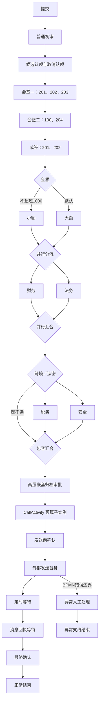

# 复杂长流程三明治测试报告（2026-09-09）

> 2026-09-10 撤回作为产品验收依据：本报告是历史执行记录。对应原生引擎长流程套件已删除，原因是绕过平台作者、部署、任务及事件入口，不能检出 UI 复测中的产品缺陷。下述命令和覆盖数字不再代表当前测试入口；后续见 WorkflowTestQualityReview-20260910.md。

状态：底层与中层已执行通过；上层完成未登录拒绝检查，登录后的 API／浏览器业务闭环尚未执行。不能据此认定三明治全层验收完成。

## 1. 实测结果

| 层次／批次 | 通过 | 失败／错误 | 跳过 | 实际边界 |
| --- | ---: | ---: | ---: | --- |
| 现有后端回归 | 326 | 0 | 0 | 规则、Mapper、服务、真实 Flowable/H2；部分外围依赖为 Mock |
| 现有 MySQL IT | 16 | 0 | 0 | 轮次、并发锁、草稿冲突、通知与保留清理等已有契约 |
| 新增长流程 H2 | 11 | 0 | 0 | 同一完整主子流程、真实 Flowable 8、Spring 事务、H2 |
| 新增长流程 MySQL | 11 | 0 | 0 | 相同长流程、真实 MySQL 8.4.9、真实竞争与事务回滚 |
| 前端合同回归 | 18 | 0 | 0 | 现有 Node 合同测试，不能代替浏览器审批 |
| 未登录真实 HTTP 检查 | 6 | 0 | 不适用 | 已核对的模型列表、流程列表、待办、完成、草稿、部署入口均返回业务 code=401；HTTP 状态为 200 |
| 登录后的 API 长流程 | 未执行 | — | — | 缺少本轮可用的测试账号凭据，已向用户请求 |
| 浏览器完整业务流程 | 未执行 | — | — | 浏览器只实测到登录页，未执行建模、发起或审批 |

这些数字来自分批执行，不是一次新增代码后的全量运行。新增 H2 测试类耗时约 20.10 秒，新增 MySQL 测试类约 25.03 秒，均为 11 个场景零跳过。

## 2. 这一条长流程

原测试资源 `long-process/procurement.bpmn20.xml` 已删除。它包括一个主流程和一个 CallActivity 子流程，合计 **38 个流程节点、37 条顺序流、16 个用户任务定义**。多实例会生成多项实际待办；节点数不等于每次执行的任务数。



这份资源使用原生 Flowable 表达式，属于引擎契约测试模型。它没有通过平台模型保存／部署编译，也没有替换此前 UI 创建的采购模型，因此不能用它关闭此前 UI 报告中的产品问题。

## 3. 组合与关键断言

下表每行均分别在 H2、MySQL 上通过。

| 用例 | 金额 | 跨境 | 涉密 | 顺序 | 预期分支 |
| --- | ---: | --- | --- | --- | --- |
| C1 | 999 | 是 | 否 | 正序 | 小额＋税务 |
| C2 | 1000 | 否 | 是 | 反序 | 小额＋安全 |
| C3 | 1001 | 是 | 是 | 正序 | 大额＋税务、安全 |
| C4 | 3000 | 否 | 否 | 反序 | 大额＋包容默认直达 |
| C5 | 999 | 是 | 是 | 反序 | 小额＋税务、安全 |
| C6 | 1001 | 否 | 是 | 正序 | 大额＋安全 |
| C7 | 1000 | 否 | 否 | 正序 | 小额＋包容默认直达 |
| C8 | 3000 | 是 | 否 | 反序 | 大额＋税务 |
| C9 | 1001 | 是 | 是 | 两个线程竞争或签 | 恰好一次提交成功、一次明确竞争失败，仅一个后继，再走完长流程 |
| C10 | 1001 | 是 | 是 | 后段发送失败后重试 | 原任务、变量、活动历史与定时作业回滚；重试后正常结束 |
| C11 | 3000 | 否 | 否 | BPMN 错误 | 只进入异常处理支线；无正常定时作业，最终到异常结束节点 |

额外逐步断言：

- 候选身份精确为 201／202；认领后再次认领失败；取消后由另一候选认领。
- 两组会签分别保持各自成员，最后一人完成前不产生下一组待办。
- 或签一人完成后其余待办消失，旧任务 ID 再提交失败。
- 并行分支只完成一条时不会进入后续；包容分支等齐实际选中的分支，不等待未选中分支。
- 两层嵌套子流程自然到达内部审批，并且只有归档完成才创建真实预算子实例。
- CallActivity 通过正式 `flowable:in/out` 映射传入金额、传回预算结果；未映射的会签成员不泄漏到子实例；父流程等待子实例完成。
- 定时器到期前不存在回执订阅；执行到期作业后才订阅回执。消息接收后只创建一个最终确认，重复回执失败。
- 正常／异常支线结束时，运行实例、执行树、任务、普通作业、定时作业、死信与事件订阅均为零，历史结束节点正确。

## 4. 真实程度及限制

新增长流程用真实 Flowable 服务驱动，不直接修改生命周期变量或数据库状态，也不通过迁移执行树把流程跳到目标节点。

服务任务使用明确的外部发送替身，不发送真实外部消息。失败用例由同一个任务完成事务进入服务任务并抛错，验证实际持久化回滚，不是测试主动写回旧状态。

定时等待使用 `PT1S`，等待实际到期后通过 ManagementService 精确执行本次实例的作业。**没有启动全局异步执行器，未证明后台自动调度**。现有应用的 `async-executor-activate: false` 保持不变；此前 UI 定时停留问题不因此关闭。

新增长流程 MySQL 测试未装配完整平台部署编译、实时用户目录／RBAC、业务生命周期监听器、附件和通知链路。因此本轮没有把这些内容归入新增长流程的已通过范围。已有回归覆盖的退回／重提／撤回／终止等是独立服务场景，也不等于它们已在这条长流程中通过。

尚未在本长流程验证：真实多账号权限、表单字段权限与附件、平台轮次快照和业务状态、平台事件入口、自动调度、DMN、信号与事件网关、事务补偿／升级、长时间运行与容量。登录账号补齐后应从正式保存部署、草稿提交及任务接口继续上层验证，并通过页面查看最终状态。

## 5. 首轮 MySQL 测试装配问题

首次新增 MySQL 执行有 11 个启动错误：测试配置默认启用 IDM，读取了隔离库中未用于当前应用的 `5.99.0.0` IDM 版本，触发 `FlowableWrongDbException`，场景尚未启动。

核对当前 `application.yml` 和已有 `WorkflowNotificationPipelineMySqlIT` 后，新测试设置 `setDisableIdmEngine(true)`、`setDisableEventRegistry(true)`，与现有应用配置一致。没有修改 schema 或版本记录。修正后 11 项全部通过；这次启动错误属于新增测试装配问题，不作为产品缺陷。

## 6. 执行与证据

PowerShell 7，工作目录为仓库根目录。MySQL 使用现有 `WORKFLOW_MYSQL_TEST_URL`、`WORKFLOW_MYSQL_TEST_USERNAME`、`WORKFLOW_MYSQL_TEST_PASSWORD`，新增 IT 强制校验目标库为 `approvaplat_it`，禁止自动建表／迁移。

```powershell
# 本轮现有基线（新增测试之前）
mvn -B -pl ruoyi-flowable -am -Pworkflow-mysql-it verify

# 本轮新增 H2 长流程
mvn -B -pl ruoyi-flowable -am '-Dtest=WorkflowLongProcessIntegrationTest' '-Dsurefire.failIfNoSpecifiedTests=false' test

# 本轮新增 MySQL 长流程，避免重复运行已经通过的 Surefire 批次
mvn -B -pl ruoyi-flowable -am -Pworkflow-mysql-it '-Dtest=NoSurefireTestsForThisMySqlRun' '-Dsurefire.failIfNoSpecifiedTests=false' '-Dit.test=WorkflowLongProcessMySqlIT' verify

# 后续需要全量验收时，第一条 verify 命令会包含新增长流程两个测试类
```

- [现有基线日志](../../output/sandwich-20260909/maven-baseline.log)
- [H2 长流程日志](../../output/sandwich-20260909/long-h2.log)
- [MySQL 长流程最终日志](../../output/sandwich-20260909/long-mysql.log)
- [MySQL 首轮装配错误日志](../../output/sandwich-20260909/long-mysql-initial-harness-error.log)
- [前端合同日志](../../output/sandwich-20260909/frontend-contracts.log)
- [HTTP 未登录检查](../../output/sandwich-20260909/http-auth-gate.json)
- [浏览器登录页截图](../../output/playwright/sandwich-login-gate.png)
- [MySQL 版本与清理回读](../../output/sandwich-20260909/mysql-cleanup.txt)

每个用例在 finally／AfterEach 中按本次部署 ID 清理，并断言主子实例及历史删除。最终只读 MySQL 查询确认本测试定义、部署、实例历史、运行任务均无残留；流程 schema 为 `8.0.0.0`。没有办理或清理原有 UI 采购实例。

本轮新增三个 Java 测试文件、一个 BPMN 资源及本报告。原有六个已修改文件 SHA-256 与开工基线一致；原有未提交报告保留。未暂存、未提交。
